---
jupyter:
  colab:
  kernelspec:
    display_name: Python 3
    language: python
    name: python3
  language_info:
    codemirror_mode:
      name: ipython
      version: 3
    file_extension: .py
    mimetype: text/x-python
    name: python
    nbconvert_exporter: python
    pygments_lexer: ipython3
    version: 3.12.3
  nbformat: 4
  nbformat_minor: 5
---
<style>
    /* Hace que TODAS las tablas del documento tengan scroll horizontal automático */
    table {
        display: block;
        width: 100%;
        overflow-x: auto;
        -webkit-overflow-scrolling: touch;
        border-collapse: collapse;
        margin-bottom: 20px;
    }
    
    /* Estilos limpios para las celdas y bordes en todas las tablas */
    th, td {
        padding: 10px 14px;
        border: 1px solid #d0d7de;
        text-align: left;
        vertical-align: top;
    }
    
    tr:nth-child(even) {
        background-color: #f6f8fa;
    }
</style>

# Analítica Exploratoria de Datos (EDA) · Adult Income 

### ¿Qué factores se asocian con ganar más de USD 50,000 al año? Una lectura desde la ingeniería, el diseño y la administración

**Proyecto ACA 1 · Programación para Analítica de Datos e Inteligencia
Artificial**

Especialización en Inteligencia Artificial

Docente: Carlos Mario Minu Quiroga

------------------------------------------------------------------------

  ---------------------------------------------------------------------------
  Integrante        Profesión            Ciudad            Lente analítico
                                                           que aporta al
                                                           proyecto
  ----------------- -------------------- ----------------- ------------------
  Luisa Fernanda    Diseñadora de        Bogotá            Narrativa visual,
  Vega Pulecio      multimedia                             accesibilidad y
                                                           comunicación de
                                                           hallazgos

  Camilo Andrey     Ingeniero de         Mocoa             Orden del proceso,
  Rojas García      sistemas                               validación de
                                                           datos y
                                                           reproducibilidad

  Diego Fernando    Ingeniero de         Bogotá            Calidad de datos y
  López León        sistemas                               código claro y
                                                           mantenible

  Johan Sebastian   Ingeniero de         Bogotá            Señal vs. ruido,
  Díaz Jiménez      telecomunicaciones                     saturación
                                                           (*clipping*) y
                                                           escalas
                                                           logarítmicas

  Jhonathan Correa  Administrador de     Pereira           Segmentación,
  Valencia          empresas                               decisiones de
                                                           negocio y
                                                           recomendaciones
  ---------------------------------------------------------------------------

> **Convención numérica:** el notebook usa punto decimal y coma como
> separador de miles (igual que las salidas de Python), por ejemplo
> `48,790` filas y `23.9 %`.

## Resumen ejecutivo

Analizamos **48,790 personas adultas** del censo de EE. UU. de 1994
(tras eliminar 52 duplicados) para entender qué características se
asocian con ingresos anuales superiores a USD 50,000. Solo **1 de cada 4
personas (23.9 %)** pertenece a ese grupo. Los hallazgos principales,
todos sustentados con evidencia en las secciones siguientes:

1.  **La educación es un escalón, no una rampa.** La tasa de ingresos
    altos pasa de 15.9 % (bachiller) a 41.3 % (pregrado) y 61.4 %
    (posgrado).
2.  **El estado civil / estructura del hogar es la variable más
    informativa.** El 44.6 % de las personas casadas supera el umbral
    frente al 4.6 % de quienes nunca se casaron; el 75.9 % de todos los
    ingresos altos corresponde a hombres casados.
3.  **Los ingresos siguen un ciclo de vida en forma de U invertida:**
    1.1 % entre 17--24 años, 39.4 % entre 45--54 y 20.5 % a partir de
    65.
4.  **Más horas ayudan, pero con rendimientos decrecientes:** la tasa
    sube hasta 44.1 % en 50--60 h/semana y cae a 35.7 % por encima de 60
    h.
5.  **La brecha de género bruta es enorme (30.4 % vs 10.9 %), pero
    desaparece entre personas casadas** (44.6 % hombres vs 44.8 %
    mujeres). Un modelo estadístico opcional (Anexo A) lo confirma: la
    razón de odds baja de 3.56 a 1.14 al considerar el estado civil.
6.  **Calidad del dato:** `fnlwgt` (peso muestral) no tiene relación con
    el ingreso; las ganancias de capital están muy concentradas (el 1 %
    de las personas acumula el 56 %) y contienen un código truncado en
    99,999; y la ausencia de ocupación es *informativa* (9.4 % de
    ingresos altos entre quienes no la reportan).


## Contenido

1.  Comprensión del problema y del dataset
2.  Configuración del entorno
3.  Obtención del dataset (cómo lo descargamos)
4.  Exploración inicial
5.  Evaluación de la calidad de los datos
6.  Limpieza y transformación
7.  Estadística descriptiva
8.  Visualización univariada
9.  Relaciones con la variable objetivo
10. Patrones e interacciones
11. Resumen visual ejecutivo
12. Del análisis a la decisión: aplicaciones por perfil profesional
13. Conclusiones, limitaciones y recomendaciones
14. Reproducibilidad y referencias

-   Anexo A (opcional): modelo estadístico de la brecha de género


------------------------------------------------------------------------

# 1. Comprensión del problema y del dataset 

## 1.1 Contexto 

El dataset **Adult** (también conocido como *Census Income*) fue
extraído por Barry Becker de la base de datos del censo de EE. UU. de
1994 y publicado en el *UCI Machine Learning Repository* (Becker &
Kohavi, 1996). Cada fila representa a **una persona adulta** y la
variable objetivo `income` indica si su ingreso anual supera los **USD
50,000** (`>50K`) o no (`<=50K`). En poder adquisitivo, ese umbral de
1994 equivale aproximadamente a más del doble en dólares de hoy.

**Pregunta central.** ¿Qué características demográficas, educativas y
laborales se asocian con pertenecer al grupo de ingresos altos, y qué
tan fuertes y confiables son esas asociaciones?

**Por qué importa (aplicabilidad):**

  -----------------------------------------------------------------------
  Ámbito                              Uso de este tipo de análisis
  ----------------------------------- -----------------------------------
  Políticas de empleo y educación     Estimar qué niveles de formación y
                                      perfiles laborales se asocian con
                                      mayor remuneración.

  Estrategia comercial                Segmentar poblaciones por poder
                                      adquisitivo para diseñar ofertas,
                                      precios y canales.

  Recursos humanos y equidad          Detectar desigualdades salariales y
                                      entender sus posibles causas
                                      estructurales.

  Ciencia de datos / IA               Preparar los datos y entender
                                      sesgos antes de construir un modelo
                                      de clasificación.
  -----------------------------------------------------------------------

> **Nota ética.** Variables como sexo, raza y país de origen son
> atributos sensibles. Las usamos **para detectar y entender
> desigualdades**, no para justificarlas ni para predecir sobre
> personas. Toda asociación que reportamos es descriptiva y **no implica
> causalidad**.

## 1.2 Preguntas guía e hipótesis de trabajo 

Antes de mirar los datos formulamos hipótesis, que contrastaremos en la
sección 13:

  -----------------------------------------------------------------------
  \#                                  Hipótesis
  ----------------------------------- -----------------------------------
  H1                                  A mayor nivel educativo, mayor
                                      probabilidad de ingresos altos.

  H2                                  La relación con la edad no es
                                      lineal: crece durante la vida
                                      laboral y se atenúa al final.

  H3                                  Trabajar más horas se asocia con
                                      ingresos altos, pero con
                                      rendimientos decrecientes.

  H4                                  Existe una brecha de género en
                                      ingresos y parte de ella puede
                                      explicarse por otras variables.

  H5                                  El tipo de ocupación y la clase de
                                      empleador segmentan fuertemente los
                                      ingresos.

  H6                                  Las ganancias de capital son poco
                                      frecuentes, están muy concentradas
                                      y se asocian fuertemente con
                                      ingresos altos.

  H7                                  La variable `fnlwgt` (peso muestral
                                      del censo) no tiene relación con el
                                      ingreso.
  -----------------------------------------------------------------------

## 1.3 Diccionario de datos 

  -----------------------------------------------------------------------
  Variable                Tipo                    Descripción
  ----------------------- ----------------------- -----------------------
  `age`                   Numérica entera         Edad en años (rango del
                                                  dataset: 17 a 90).

  `workclass`             Categórica              Clase de empleador:
                                                  privado, gobierno,
                                                  independiente
                                                  (incorporado o no), sin
                                                  pago, nunca ha
                                                  trabajado.

  `fnlwgt`                Numérica                *Final weight*: número
                                                  de personas de la
                                                  población que
                                                  representa cada
                                                  registro (peso de
                                                  muestreo del censo).

  `education`             Categórica ordinal      Máximo nivel educativo
                                                  alcanzado (16
                                                  categorías).

  `education_num`         Numérica ordinal        Codificación numérica
                                                  de `education` (1 =
                                                  preescolar ... 16 =
                                                  doctorado).

  `marital_status`        Categórica              Estado civil (7
                                                  categorías).

  `occupation`            Categórica              Ocupación (14
                                                  categorías).

  `relationship`          Categórica              Rol dentro del hogar
                                                  (esposo/a, hijo/a, no
                                                  familiar, etc.).

  `race`                  Categórica              Raza reportada (5
                                                  categorías).

  `sex`                   Categórica              Sexo reportado (Male /
                                                  Female).

  `capital_gain`          Numérica                Ganancias de capital
                                                  del año (USD).

  `capital_loss`          Numérica                Pérdidas de capital del
                                                  año (USD).

  `hours_per_week`        Numérica entera         Horas trabajadas por
                                                  semana.

  `native_country`        Categórica              País de origen (41
                                                  categorías).

  **`income`**            **Objetivo**            `<=50K` o `>50K` de
                                                  ingreso anual.
  -----------------------------------------------------------------------

## 1.4 Cómo trabajamos como equipo 

Seguimos un ciclo corto inspirado en CRISP-DM: **comprender → auditar
los datos → preparar → explorar → interpretar → recomendar**. Cada
integrante aportó el lente de su profesión; esos lentes aparecen como
recuadros *«Lente · ...»* a lo largo del documento y se consolidan en la
sección 12.


------------------------------------------------------------------------

# 2. Configuración del entorno 

> **Lente · Diseño multimedia.** Usamos la paleta *Okabe-Ito*, pensada
> para que se lea bien con daltonismo, y una codificación consistente:
> azul = ingresos `<=50K`, naranja = ingresos `>50K`. Para otra variable
> (el sexo) usamos otros colores, de modo que un mismo color nunca
> signifique dos cosas.


``` python
# --- Librerías
import pandas as pd                      # tablas de datos
import numpy as np                       # cálculos numéricos
import matplotlib.pyplot as plt          # gráficos
import seaborn as sns                    # gráficos estadísticos
from scipy.stats import chi2_contingency # prueba chi-cuadrado
import warnings
warnings.filterwarnings("ignore")        # oculta avisos que no afectan los resultados

# --- Estilo general de los gráficos
sns.set_theme(style="whitegrid")
plt.rcParams["figure.dpi"] = 110
plt.rcParams["axes.titleweight"] = "bold"
plt.rcParams["axes.titlelocation"] = "left"

# --- Colores (paleta Okabe-Ito)
AZUL, NARANJA, GRIS = "#0072B2", "#E69F00", "#6B7280"   # <=50K | >50K | neutro
ROSA, VERDE = "#CC79A7", "#009E73"                       # mujeres | hombres

SEMILLA = 42   # fija el azar (los intervalos de confianza de los gráficos) para repetir resultados

# --- Cómo se muestran los números en las tablas
pd.set_option("display.max_columns", 40)
pd.set_option("display.float_format", "{:,.2f}".format)

print("pandas", pd.__version__, "| numpy", np.__version__, "| seaborn", sns.__version__)
```

    pandas 2.2.3 | numpy 2.4.6 | seaborn 0.13.2

------------------------------------------------------------------------

# 3. Obtención del dataset (cómo lo descargamos) 

El dataset **no viene precargado** en `scikit-learn`, `seaborn` ni en
Python base: `scikit-learn` solo ofrece una función que lo descarga de
OpenML. Evaluamos tres rutas:

  ----------------------------------------------------------------------------------------------------------------------
  Ruta              Mecanismo                                                       Ventaja            Limitación
  ----------------- --------------------------------------------------------------- ------------------ -----------------
  **A. GitHub       `pd.read_csv` sobre el archivo *raw* de                         Una sola línea,    No trae
  (usada)**         [`jbrownlee/Datasets`](https://github.com/jbrownlee/Datasets)   sin cuenta ni API; encabezados: los
                    (`adult-all.csv`)                                               es el archivo      asignamos
                                                                                    original de UCI    nosotros según la
                                                                                    (entrenamiento +   documentación de
                                                                                    prueba, 48,842     UCI
                                                                                    filas)             

  B. OpenML         `fetch_openml("adult", version=2)` de scikit-learn              Trae nombres de    Requiere acceso a
                                                                                    columnas           openml.org

  C. UCI directo    Descarga de `adult.data` y `adult.test` desde                   Fuente primaria    Hay que unir dos
                    `archive.ics.uci.edu`                                                              archivos y
                                                                                                       corregir un punto
                                                                                                       final (`<=50K.`)
                                                                                                       en el de prueba
  ----------------------------------------------------------------------------------------------------------------------

**Decisión:** usamos la ruta A. Los nombres de columna se tomaron de la
documentación oficial de UCI (`adult.names`) y se escribieron en
`snake_case`. Conservamos una copia intacta de los datos originales en
`df_raw` y todo lo demás se hace sobre copias.

``` python
# Nombres de las 15 columnas (según la documentación de UCI; el archivo no trae encabezados)
columnas = ["age", "workclass", "fnlwgt", "education", "education_num", "marital_status",
            "occupation", "relationship", "race", "sex", "capital_gain", "capital_loss",
            "hours_per_week", "native_country", "income"]

# Dirección del archivo en GitHub
url = "https://raw.githubusercontent.com/jbrownlee/Datasets/master/adult-all.csv"

# Descarga y lectura (header=None: no hay encabezado; skipinitialspace: quita espacios tras la coma)
df_raw = pd.read_csv(url, header=None, names=columnas, skipinitialspace=True)

# Alternativa si GitHub no responde (quitar el # para usarla):
# from sklearn.datasets import fetch_openml
# df_raw = fetch_openml("adult", version=2, as_frame=True).frame

print(f"Dimensiones: {df_raw.shape[0]:,} filas × {df_raw.shape[1]} columnas")
df_raw.head()
```

    Dimensiones: 48,842 filas × 15 columnas


``` json
{"summary":"{\n  \"name\": \"df_raw\",\n  \"rows\": 48842,\n  \"fields\": [\n    {\n      \"column\": \"age\",\n      \"properties\": {\n        \"dtype\": \"number\",\n        \"std\": 13,\n        \"min\": 17,\n        \"max\": 90,\n        \"num_unique_values\": 74,\n        \"samples\": [\n          28,\n          73,\n          35\n        ],\n        \"semantic_type\": \"\",\n        \"description\": \"\"\n      }\n    },\n    {\n      \"column\": \"workclass\",\n      \"properties\": {\n        \"dtype\": \"category\",\n        \"num_unique_values\": 9,\n        \"samples\": [\n          \"Without-pay\",\n          \"Self-emp-not-inc\",\n          \"?\"\n        ],\n        \"semantic_type\": \"\",\n        \"description\": \"\"\n      }\n    },\n    {\n      \"column\": \"fnlwgt\",\n      \"properties\": {\n        \"dtype\": \"number\",\n        \"std\": 105604,\n        \"min\": 12285,\n        \"max\": 1490400,\n        \"num_unique_values\": 28523,\n        \"samples\": [\n          159077,\n          199450,\n          181773\n        ],\n        \"semantic_type\": \"\",\n        \"description\": \"\"\n      }\n    },\n    {\n      \"column\": \"education\",\n      \"properties\": {\n        \"dtype\": \"category\",\n        \"num_unique_values\": 16,\n        \"samples\": [\n          \"Bachelors\",\n          \"HS-grad\",\n          \"Some-college\"\n        ],\n        \"semantic_type\": \"\",\n        \"description\": \"\"\n      }\n    },\n    {\n      \"column\": \"education_num\",\n      \"properties\": {\n        \"dtype\": \"number\",\n        \"std\": 2,\n        \"min\": 1,\n        \"max\": 16,\n        \"num_unique_values\": 16,\n        \"samples\": [\n          13,\n          9,\n          10\n        ],\n        \"semantic_type\": \"\",\n        \"description\": \"\"\n      }\n    },\n    {\n      \"column\": \"marital_status\",\n      \"properties\": {\n        \"dtype\": \"category\",\n        \"num_unique_values\": 7,\n        \"samples\": [\n          \"Never-married\",\n          \"Married-civ-spouse\",\n          \"Married-AF-spouse\"\n        ],\n        \"semantic_type\": \"\",\n        \"description\": \"\"\n      }\n    },\n    {\n      \"column\": \"occupation\",\n      \"properties\": {\n        \"dtype\": \"category\",\n        \"num_unique_values\": 15,\n        \"samples\": [\n          \"Machine-op-inspct\",\n          \"?\",\n          \"Adm-clerical\"\n        ],\n        \"semantic_type\": \"\",\n        \"description\": \"\"\n      }\n    },\n    {\n      \"column\": \"relationship\",\n      \"properties\": {\n        \"dtype\": \"category\",\n        \"num_unique_values\": 6,\n        \"samples\": [\n          \"Not-in-family\",\n          \"Husband\",\n          \"Other-relative\"\n        ],\n        \"semantic_type\": \"\",\n        \"description\": \"\"\n      }\n    },\n    {\n      \"column\": \"race\",\n      \"properties\": {\n        \"dtype\": \"category\",\n        \"num_unique_values\": 5,\n        \"samples\": [\n          \"Black\",\n          \"Other\",\n          \"Asian-Pac-Islander\"\n        ],\n        \"semantic_type\": \"\",\n        \"description\": \"\"\n      }\n    },\n    {\n      \"column\": \"sex\",\n      \"properties\": {\n        \"dtype\": \"category\",\n        \"num_unique_values\": 2,\n        \"samples\": [\n          \"Female\",\n          \"Male\"\n        ],\n        \"semantic_type\": \"\",\n        \"description\": \"\"\n      }\n    },\n    {\n      \"column\": \"capital_gain\",\n      \"properties\": {\n        \"dtype\": \"number\",\n        \"std\": 7452,\n        \"min\": 0,\n        \"max\": 99999,\n        \"num_unique_values\": 123,\n        \"samples\": [\n          2176,\n          10520\n        ],\n        \"semantic_type\": \"\",\n        \"description\": \"\"\n      }\n    },\n    {\n      \"column\": \"capital_loss\",\n      \"properties\": {\n        \"dtype\": \"number\",\n        \"std\": 403,\n        \"min\": 0,\n        \"max\": 4356,\n        \"num_unique_values\": 99,\n        \"samples\": [\n          1974,\n          419\n        ],\n        \"semantic_type\": \"\",\n        \"description\": \"\"\n      }\n    },\n    {\n      \"column\": \"hours_per_week\",\n      \"properties\": {\n        \"dtype\": \"number\",\n        \"std\": 12,\n        \"min\": 1,\n        \"max\": 99,\n        \"num_unique_values\": 96,\n        \"samples\": [\n          97,\n          88\n        ],\n        \"semantic_type\": \"\",\n        \"description\": \"\"\n      }\n    },\n    {\n      \"column\": \"native_country\",\n      \"properties\": {\n        \"dtype\": \"category\",\n        \"num_unique_values\": 42,\n        \"samples\": [\n          \"El-Salvador\",\n          \"Philippines\"\n        ],\n        \"semantic_type\": \"\",\n        \"description\": \"\"\n      }\n    },\n    {\n      \"column\": \"income\",\n      \"properties\": {\n        \"dtype\": \"category\",\n        \"num_unique_values\": 2,\n        \"samples\": [\n          \">50K\",\n          \"<=50K\"\n        ],\n        \"semantic_type\": \"\",\n        \"description\": \"\"\n      }\n    }\n  ]\n}","type":"dataframe","variable_name":"df_raw"}
```

**Lectura.** Obtuvimos **48,842 registros y 15 columnas**, que coinciden
con la documentación oficial de UCI (32,561 de entrenamiento + 16,281 de
prueba). Los datos originales quedan guardados en `df_raw` sin
modificar, para poder auditar cada decisión de limpieza.


------------------------------------------------------------------------

# 4. Exploración inicial {#4-exploración-inicial}

Antes de limpiar nada revisamos la estructura general: tipos de dato,
cantidad de valores distintos y un vistazo a los registros.

``` python
# Tipos de dato y valores no nulos
df_raw.info()

# Cantidad de valores distintos por columna
print("\nValores distintos por columna:")
print(df_raw.nunique())

# Una muestra aleatoria de 5 filas
df_raw.sample(5, random_state=SEMILLA)
```


    <class 'pandas.core.frame.DataFrame'>
    RangeIndex: 48842 entries, 0 to 48841
    Data columns (total 15 columns):
     #   Column          Non-Null Count  Dtype 
    ---  ------          --------------  ----- 
     0   age             48842 non-null  int64 
     1   workclass       48842 non-null  object
     2   fnlwgt          48842 non-null  int64 
     3   education       48842 non-null  object
     4   education_num   48842 non-null  int64 
     5   marital_status  48842 non-null  object
     6   occupation      48842 non-null  object
     7   relationship    48842 non-null  object
     8   race            48842 non-null  object
     9   sex             48842 non-null  object
     10  capital_gain    48842 non-null  int64 
     11  capital_loss    48842 non-null  int64 
     12  hours_per_week  48842 non-null  int64 
     13  native_country  48842 non-null  object
     14  income          48842 non-null  object
    dtypes: int64(6), object(9)
    memory usage: 5.6+ MB

    Valores distintos por columna:
    age                  74
    workclass             9
    fnlwgt            28523
    education            16
    education_num        16
    marital_status        7
    occupation           15
    relationship          6
    race                  5
    sex                   2
    capital_gain        123
    capital_loss         99
    hours_per_week       96
    native_country       42
    income                2
    dtype: int64

``` json
{"summary":"{\n  \"name\": \"df_raw\",\n  \"rows\": 5,\n  \"fields\": [\n    {\n      \"column\": \"age\",\n      \"properties\": {\n        \"dtype\": \"number\",\n        \"std\": 12,\n        \"min\": 17,\n        \"max\": 47,\n        \"num_unique_values\": 5,\n        \"samples\": [\n          17,\n          47,\n          25\n        ],\n        \"semantic_type\": \"\",\n        \"description\": \"\"\n      }\n    },\n    {\n      \"column\": \"workclass\",\n      \"properties\": {\n        \"dtype\": \"category\",\n        \"num_unique_values\": 2,\n        \"samples\": [\n          \"Local-gov\",\n          \"Private\"\n        ],\n        \"semantic_type\": \"\",\n        \"description\": \"\"\n      }\n    },\n    {\n      \"column\": \"fnlwgt\",\n      \"properties\": {\n        \"dtype\": \"number\",\n        \"std\": 100625,\n        \"min\": 178953,\n        \"max\": 423024,\n        \"num_unique_values\": 5,\n        \"samples\": [\n          178953,\n          244025\n        ],\n        \"semantic_type\": \"\",\n        \"description\": \"\"\n      }\n    },\n    {\n      \"column\": \"education\",\n      \"properties\": {\n        \"dtype\": \"string\",\n        \"num_unique_values\": 3,\n        \"samples\": [\n          \"HS-grad\",\n          \"12th\"\n        ],\n        \"semantic_type\": \"\",\n        \"description\": \"\"\n      }\n    },\n    {\n      \"column\": \"education_num\",\n      \"properties\": {\n        \"dtype\": \"number\",\n        \"std\": 0,\n        \"min\": 8,\n        \"max\": 10,\n        \"num_unique_values\": 3,\n        \"samples\": [\n          9,\n          8\n        ],\n        \"semantic_type\": \"\",\n        \"description\": \"\"\n      }\n    },\n    {\n      \"column\": \"marital_status\",\n      \"properties\": {\n        \"dtype\": \"category\",\n        \"num_unique_values\": 1,\n        \"samples\": [\n          \"Never-married\"\n        ],\n        \"semantic_type\": \"\",\n        \"description\": \"\"\n      }\n    },\n    {\n      \"column\": \"occupation\",\n      \"properties\": {\n        \"dtype\": \"string\",\n        \"num_unique_values\": 4,\n        \"samples\": [\n          \"Sales\"\n        ],\n        \"semantic_type\": \"\",\n        \"description\": \"\"\n      }\n    },\n    {\n      \"column\": \"relationship\",\n      \"properties\": {\n        \"dtype\": \"string\",\n        \"num_unique_values\": 4,\n        \"samples\": [\n          \"Own-child\"\n        ],\n        \"semantic_type\": \"\",\n        \"description\": \"\"\n      }\n    },\n    {\n      \"column\": \"race\",\n      \"properties\": {\n        \"dtype\": \"string\",\n        \"num_unique_values\": 3,\n        \"samples\": [\n          \"White\"\n        ],\n        \"semantic_type\": \"\",\n        \"description\": \"\"\n      }\n    },\n    {\n      \"column\": \"sex\",\n      \"properties\": {\n        \"dtype\": \"category\",\n        \"num_unique_values\": 2,\n        \"samples\": [\n          \"Female\"\n        ],\n        \"semantic_type\": \"\",\n        \"description\": \"\"\n      }\n    },\n    {\n      \"column\": \"capital_gain\",\n      \"properties\": {\n        \"dtype\": \"number\",\n        \"std\": 0,\n        \"min\": 0,\n        \"max\": 0,\n        \"num_unique_values\": 1,\n        \"samples\": [\n          0\n        ],\n        \"semantic_type\": \"\",\n        \"description\": \"\"\n      }\n    },\n    {\n      \"column\": \"capital_loss\",\n      \"properties\": {\n        \"dtype\": \"number\",\n        \"std\": 0,\n        \"min\": 0,\n        \"max\": 0,\n        \"num_unique_values\": 1,\n        \"samples\": [\n          0\n        ],\n        \"semantic_type\": \"\",\n        \"description\": \"\"\n      }\n    },\n    {\n      \"column\": \"hours_per_week\",\n      \"properties\": {\n        \"dtype\": \"number\",\n        \"std\": 15,\n        \"min\": 20,\n        \"max\": 56,\n        \"num_unique_values\": 4,\n        \"samples\": [\n          40\n        ],\n        \"semantic_type\": \"\",\n        \"description\": \"\"\n      }\n    },\n    {\n      \"column\": \"native_country\",\n      \"properties\": {\n        \"dtype\": \"category\",\n        \"num_unique_values\": 2,\n        \"samples\": [\n          \"Puerto-Rico\"\n        ],\n        \"semantic_type\": \"\",\n        \"description\": \"\"\n      }\n    },\n    {\n      \"column\": \"income\",\n      \"properties\": {\n        \"dtype\": \"category\",\n        \"num_unique_values\": 1,\n        \"samples\": [\n          \"<=50K\"\n        ],\n        \"semantic_type\": \"\",\n        \"description\": \"\"\n      }\n    }\n  ]\n}","type":"dataframe"}
```

**Lectura.**

-   Hay **6 variables numéricas** (`age`, `fnlwgt`, `education_num`,
    `capital_gain`, `capital_loss`, `hours_per_week`) y **9
    categóricas**, incluida la variable objetivo `income`.
-   `info()` no reporta nulos, pero eso es engañoso: **el archivo
    codifica los datos faltantes con el texto `"?"`**, que pandas lee
    como una categoría más. Lo comprobamos en la sección 5.
-   `education` y `education_num` tienen 16 valores distintos cada una:
    parecen representar **la misma información** y lo verificaremos.
-   `fnlwgt` tiene decenas de miles de valores distintos: no es una
    característica de la persona sino un **peso de muestreo**.


------------------------------------------------------------------------

# 5. Evaluación de la calidad de los datos 

Auditamos cinco aspectos: **datos faltantes**, **duplicados**,
**inconsistencias**, **valores atípicos o truncados** y **balance** de
la variable objetivo.

## 5.1 Datos faltantes 

``` python
# (a) Contamos cuántas veces aparece el "?" en las columnas de texto
cols_texto = df_raw.select_dtypes(exclude="number").columns
signos = (df_raw[cols_texto] == "?").sum()
print("Cantidad de '?' por columna (solo las que tienen):")
print(signos[signos > 0])

# (b) Convertimos el "?" en un faltante real (NaN) para poder auditarlo
df_nan = df_raw.replace("?", np.nan)

faltantes = df_nan.isna().sum()
porcentaje = faltantes / len(df_nan) * 100
tabla_faltantes = pd.DataFrame({"n_faltantes": faltantes, "% del total": porcentaje})
tabla_faltantes = tabla_faltantes[tabla_faltantes["n_faltantes"] > 0]
print("\nResumen de faltantes:")
display(tabla_faltantes)

# (c) ¿Faltan juntos workclass y occupation?
print("Cruce de faltantes (workclass × occupation):")
display(pd.crosstab(df_nan["workclass"].isna(), df_nan["occupation"].isna(),
                    rownames=["workclass falta"], colnames=["occupation falta"]))

# Las 10 personas con ocupación faltante pero workclass presente, ¿quiénes son?
print("Casos con ocupación faltante y workclass presente:")
print(df_nan.loc[df_nan["workclass"].notna() & df_nan["occupation"].isna(), "workclass"].value_counts())

# (d) ¿Los faltantes son "al azar"? Comparamos el % de ingresos altos
falta_ocupacion = df_nan["occupation"].isna()
print("\n% de personas por nivel de ingreso, según si falta la ocupación:")
print(pd.crosstab(falta_ocupacion, df_nan["income"], normalize="index") * 100)

chi2, p, gl, esperados = chi2_contingency(pd.crosstab(falta_ocupacion, df_nan["income"]))
print(f"Prueba chi-cuadrado: p-valor = {p:.1e}")

falta_pais = df_nan["native_country"].isna()
print("\n% de personas por nivel de ingreso, según si falta el país de origen:")
print(pd.crosstab(falta_pais, df_nan["income"], normalize="index") * 100)

# (e) Gráfico
plt.figure(figsize=(7, 2.6))
tabla_faltantes["% del total"].sort_values().plot(kind="barh", color=NARANJA)
plt.title("Solo 3 variables tienen datos faltantes (ninguna supera el 6 %)")
plt.xlabel("% de registros con dato faltante")
plt.show()
```


    Cantidad de '?' por columna (solo las que tienen):
    workclass         2799
    occupation        2809
    native_country     857
    dtype: int64

    Resumen de faltantes:

``` json
{"summary":"{\n  \"name\": \"tabla_faltantes\",\n  \"rows\": 3,\n  \"fields\": [\n    {\n      \"column\": \"n_faltantes\",\n      \"properties\": {\n        \"dtype\": \"number\",\n        \"std\": 1124,\n        \"min\": 857,\n        \"max\": 2809,\n        \"num_unique_values\": 3,\n        \"samples\": [\n          2799,\n          2809,\n          857\n        ],\n        \"semantic_type\": \"\",\n        \"description\": \"\"\n      }\n    },\n    {\n      \"column\": \"% del total\",\n      \"properties\": {\n        \"dtype\": \"number\",\n        \"std\": 2.301527566550676,\n        \"min\": 1.7546374022357807,\n        \"max\": 5.751197739650301,\n        \"num_unique_values\": 3,\n        \"samples\": [\n          5.7307235575938735,\n          5.751197739650301,\n          1.7546374022357807\n        ],\n        \"semantic_type\": \"\",\n        \"description\": \"\"\n      }\n    }\n  ]\n}","type":"dataframe","variable_name":"tabla_faltantes"}
```

    Cruce de faltantes (workclass × occupation):

``` json
{"summary":"{\n  \"name\": \"plt\",\n  \"rows\": 2,\n  \"fields\": [\n    {\n      \"column\": \"workclass falta\",\n      \"properties\": {\n        \"dtype\": \"boolean\",\n        \"num_unique_values\": 2,\n        \"samples\": [\n          true,\n          false\n        ],\n        \"semantic_type\": \"\",\n        \"description\": \"\"\n      }\n    },\n    {\n      \"column\": false,\n      \"properties\": {\n        \"dtype\": \"number\",\n        \"std\": 32550,\n        \"min\": 0,\n        \"max\": 46033,\n        \"num_unique_values\": 2,\n        \"samples\": [\n          0,\n          46033\n        ],\n        \"semantic_type\": \"\",\n        \"description\": \"\"\n      }\n    },\n    {\n      \"column\": true,\n      \"properties\": {\n        \"dtype\": \"number\",\n        \"std\": 1972,\n        \"min\": 10,\n        \"max\": 2799,\n        \"num_unique_values\": 2,\n        \"samples\": [\n          2799,\n          10\n        ],\n        \"semantic_type\": \"\",\n        \"description\": \"\"\n      }\n    }\n  ]\n}","type":"dataframe"}
```

    Casos con ocupación faltante y workclass presente:
    workclass
    Never-worked    10
    Name: count, dtype: int64

    % de personas por nivel de ingreso, según si falta la ocupación:
    income      <=50K  >50K
    occupation             
    False       75.19 24.81
    True        90.57  9.43
    Prueba chi-cuadrado: p-valor = 1.3e-76

    % de personas por nivel de ingreso, según si falta el país de origen:
    income          <=50K  >50K
    native_country             
    False           76.10 23.90
    True            74.33 25.67

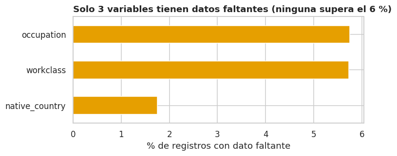

**Interpretación.**

-   Los faltantes están en **`workclass` (2,799), `occupation` (2,809) y
    `native_country` (857)**; ninguno supera el 6 % de los registros.
-   `workclass` y `occupation` **faltan casi siempre juntos** (2,799
    casos). Las 10 filas con ocupación faltante y clase de empleador
    presente son todas `Never-worked`, lo cual es **lógico**: quien
    nunca trabajó no tiene ocupación. Estos faltantes no son errores de
    captura sino **personas sin vínculo laboral reportado**.
-   **El faltante es informativo, no aleatorio.** Entre quienes no
    reportan ocupación solo \~9 % tiene ingresos altos, frente a \~25 %
    de quienes sí la reportan (diferencia muy significativa: p ≈ 1e-76).
    Si rellenáramos con la moda (la ocupación más frecuente) estaríamos
    asignando a un grupo de bajos ingresos el perfil de uno de ingresos
    medios-altos y **sesgaríamos el análisis**.
-   En cambio, entre quienes no reportan `native_country` la tasa (25.7
    %) es casi igual al promedio: ahí el faltante parece aleatorio, pero
    son solo 857 registros.

**Decisión (se aplica en la sección 6):** no eliminar filas ni rellenar
con la moda. Se crea la categoría explícita **`"No reporta"`**, que
conserva la información de que el dato no fue declarado.

## 5.2 Registros duplicados 

``` python
# Filas idénticas en las 15 columnas
duplicadas = df_nan.duplicated()
print(f"Filas duplicadas: {duplicadas.sum()} ({duplicadas.mean():.2%} del total)")

# Ejemplos de duplicados
print("\nEjemplos:")
display(df_nan[df_nan.duplicated(keep=False)].sort_values(columnas).head(6))

# ¿Cambia la conclusión si los conservamos? Comparamos la tasa de ingresos altos
tasa_con = (df_nan["income"] == ">50K").mean() * 100
tasa_sin = (df_nan[~duplicadas]["income"] == ">50K").mean() * 100
print(f"\nTasa de ingresos altos CON duplicados: {tasa_con:.3f} %")
print(f"Tasa de ingresos altos SIN duplicados: {tasa_sin:.3f} %")
print(f"Diferencia: {abs(tasa_con - tasa_sin):.3f} puntos porcentuales")
```


    Filas duplicadas: 52 (0.11% del total)

    Ejemplos:

``` json
{"summary":"{\n  \"name\": \"print(f\\\"Diferencia: {abs(tasa_con - tasa_sin):\",\n  \"rows\": 6,\n  \"fields\": [\n    {\n      \"column\": \"age\",\n      \"properties\": {\n        \"dtype\": \"number\",\n        \"std\": 0,\n        \"min\": 17,\n        \"max\": 19,\n        \"num_unique_values\": 3,\n        \"samples\": [\n          17,\n          18,\n          19\n        ],\n        \"semantic_type\": \"\",\n        \"description\": \"\"\n      }\n    },\n    {\n      \"column\": \"workclass\",\n      \"properties\": {\n        \"dtype\": \"category\",\n        \"num_unique_values\": 2,\n        \"samples\": [\n          \"Self-emp-inc\",\n          \"Private\"\n        ],\n        \"semantic_type\": \"\",\n        \"description\": \"\"\n      }\n    },\n    {\n      \"column\": \"fnlwgt\",\n      \"properties\": {\n        \"dtype\": \"number\",\n        \"std\": 132953,\n        \"min\": 97261,\n        \"max\": 378036,\n        \"num_unique_values\": 3,\n        \"samples\": [\n          153021,\n          378036\n        ],\n        \"semantic_type\": \"\",\n        \"description\": \"\"\n      }\n    },\n    {\n      \"column\": \"education\",\n      \"properties\": {\n        \"dtype\": \"category\",\n        \"num_unique_values\": 2,\n        \"samples\": [\n          \"HS-grad\",\n          \"12th\"\n        ],\n        \"semantic_type\": \"\",\n        \"description\": \"\"\n      }\n    },\n    {\n      \"column\": \"education_num\",\n      \"properties\": {\n        \"dtype\": \"number\",\n        \"std\": 0,\n        \"min\": 8,\n        \"max\": 9,\n        \"num_unique_values\": 2,\n        \"samples\": [\n          9,\n          8\n        ],\n        \"semantic_type\": \"\",\n        \"description\": \"\"\n      }\n    },\n    {\n      \"column\": \"marital_status\",\n      \"properties\": {\n        \"dtype\": \"category\",\n        \"num_unique_values\": 1,\n        \"samples\": [\n          \"Never-married\"\n        ],\n        \"semantic_type\": \"\",\n        \"description\": \"\"\n      }\n    },\n    {\n      \"column\": \"occupation\",\n      \"properties\": {\n        \"dtype\": \"category\",\n        \"num_unique_values\": 2,\n        \"samples\": [\n          \"Farming-fishing\"\n        ],\n        \"semantic_type\": \"\",\n        \"description\": \"\"\n      }\n    },\n    {\n      \"column\": \"relationship\",\n      \"properties\": {\n        \"dtype\": \"category\",\n        \"num_unique_values\": 2,\n        \"samples\": [\n          \"Not-in-family\"\n        ],\n        \"semantic_type\": \"\",\n        \"description\": \"\"\n      }\n    },\n    {\n      \"column\": \"race\",\n      \"properties\": {\n        \"dtype\": \"category\",\n        \"num_unique_values\": 1,\n        \"samples\": [\n          \"White\"\n        ],\n        \"semantic_type\": \"\",\n        \"description\": \"\"\n      }\n    },\n    {\n      \"column\": \"sex\",\n      \"properties\": {\n        \"dtype\": \"category\",\n        \"num_unique_values\": 2,\n        \"samples\": [\n          \"Male\"\n        ],\n        \"semantic_type\": \"\",\n        \"description\": \"\"\n      }\n    },\n    {\n      \"column\": \"capital_gain\",\n      \"properties\": {\n        \"dtype\": \"number\",\n        \"std\": 0,\n        \"min\": 0,\n        \"max\": 0,\n        \"num_unique_values\": 1,\n        \"samples\": [\n          0\n        ],\n        \"semantic_type\": \"\",\n        \"description\": \"\"\n      }\n    },\n    {\n      \"column\": \"capital_loss\",\n      \"properties\": {\n        \"dtype\": \"number\",\n        \"std\": 0,\n        \"min\": 0,\n        \"max\": 0,\n        \"num_unique_values\": 1,\n        \"samples\": [\n          0\n        ],\n        \"semantic_type\": \"\",\n        \"description\": \"\"\n      }\n    },\n    {\n      \"column\": \"hours_per_week\",\n      \"properties\": {\n        \"dtype\": \"number\",\n        \"std\": 13,\n        \"min\": 10,\n        \"max\": 40,\n        \"num_unique_values\": 3,\n        \"samples\": [\n          20\n        ],\n        \"semantic_type\": \"\",\n        \"description\": \"\"\n      }\n    },\n    {\n      \"column\": \"native_country\",\n      \"properties\": {\n        \"dtype\": \"category\",\n        \"num_unique_values\": 1,\n        \"samples\": [\n          \"United-States\"\n        ],\n        \"semantic_type\": \"\",\n        \"description\": \"\"\n      }\n    },\n    {\n      \"column\": \"income\",\n      \"properties\": {\n        \"dtype\": \"category\",\n        \"num_unique_values\": 1,\n        \"samples\": [\n          \"<=50K\"\n        ],\n        \"semantic_type\": \"\",\n        \"description\": \"\"\n      }\n    }\n  ]\n}","type":"dataframe"}
```


    Tasa de ingresos altos CON duplicados: 23.928 %
    Tasa de ingresos altos SIN duplicados: 23.941 %
    Diferencia: 0.013 puntos porcentuales

**Interpretación.** Hay **52 filas duplicadas** (0.11 %). Como el
archivo no tiene identificador de persona, no podemos saber con certeza
si son errores de captura o personas distintas con perfiles idénticos.
Dado que coinciden en las **15 variables a la vez** y que su impacto es
**mínimo** (la tasa de ingresos altos cambia en ≈ 0.01 puntos
porcentuales), adoptamos el criterio conservador de **eliminarlos**:
evita inflar perfiles repetidos y no altera ninguna conclusión.

## 5.3 Inconsistencias y valores truncados 

``` python
# (a) Espacios sobrantes en el texto y valores de la variable objetivo
sobrantes = {c: (df_nan[c].dropna() != df_nan[c].dropna().str.strip()).sum() for c in cols_texto}
print("Celdas con espacios sobrantes:", sum(sobrantes.values()))
print("Valores de income:", df_nan["income"].unique())

# (b) ¿education y education_num son lo mismo? Cada código debe tener una sola etiqueta
etiquetas_por_codigo = df_nan.groupby("education_num")["education"].nunique()
print("\nMáximo de etiquetas distintas por código de educación:", etiquetas_por_codigo.max(), "(1 = relación uno a uno)")
print(df_nan.groupby("education_num")["education"].first().to_string())

# (c) ¿relationship y sex son coherentes? (Husband debería ser hombre, Wife mujer)
display(pd.crosstab(df_nan["relationship"], df_nan["sex"]))

# (d) Valores truncados o sospechosos
print("\nEdad máxima:", df_nan["age"].max(), "| personas con 90 años:", (df_nan["age"] == 90).sum())
print("Horas máximas:", df_nan["hours_per_week"].max(), "| personas con 99 h:", (df_nan["hours_per_week"] == 99).sum())
print("Ganancia de capital máxima:", df_nan["capital_gain"].max(), "| personas con 99,999:", (df_nan["capital_gain"] == 99999).sum())
alto_99999 = (df_nan[df_nan["capital_gain"] == 99999]["income"] == ">50K").mean()
print(f"% de ingresos altos entre quienes tienen 99,999: {alto_99999:.0%}")
print("Personas con pregrado o más y menos de 19 años:", ((df_nan["education_num"] >= 13) & (df_nan["age"] < 19)).sum())

print("\nHoras por semana: los 6 valores más frecuentes (proporción)")
print(df_nan["hours_per_week"].value_counts(normalize=True).head(6))
```


    Celdas con espacios sobrantes: 0
    Valores de income: ['<=50K' '>50K']

    Máximo de etiquetas distintas por código de educación: 1 (1 = relación uno a uno)
    education_num
    1        Preschool
    2          1st-4th
    3          5th-6th
    4          7th-8th
    5              9th
    6             10th
    7             11th
    8             12th
    9          HS-grad
    10    Some-college
    11       Assoc-voc
    12      Assoc-acdm
    13       Bachelors
    14         Masters
    15     Prof-school
    16       Doctorate

``` json
{"summary":"{\n  \"name\": \"print(df_nan[\\\"hours_per_week\\\"]\",\n  \"rows\": 6,\n  \"fields\": [\n    {\n      \"column\": \"relationship\",\n      \"properties\": {\n        \"dtype\": \"string\",\n        \"num_unique_values\": 6,\n        \"samples\": [\n          \"Husband\",\n          \"Not-in-family\",\n          \"Wife\"\n        ],\n        \"semantic_type\": \"\",\n        \"description\": \"\"\n      }\n    },\n    {\n      \"column\": \"Female\",\n      \"properties\": {\n        \"dtype\": \"number\",\n        \"std\": 2167,\n        \"min\": 1,\n        \"max\": 5870,\n        \"num_unique_values\": 6,\n        \"samples\": [\n          1,\n          5870,\n          2328\n        ],\n        \"semantic_type\": \"\",\n        \"description\": \"\"\n      }\n    },\n    {\n      \"column\": \"Male\",\n      \"properties\": {\n        \"dtype\": \"number\",\n        \"std\": 7427,\n        \"min\": 3,\n        \"max\": 19715,\n        \"num_unique_values\": 6,\n        \"samples\": [\n          19715,\n          6713,\n          3\n        ],\n        \"semantic_type\": \"\",\n        \"description\": \"\"\n      }\n    }\n  ]\n}","type":"dataframe"}
```


    Edad máxima: 90 | personas con 90 años: 55
    Horas máximas: 99 | personas con 99 h: 137
    Ganancia de capital máxima: 99999 | personas con 99,999: 244
    % de ingresos altos entre quienes tienen 99,999: 100%
    Personas con pregrado o más y menos de 19 años: 1

    Horas por semana: los 6 valores más frecuentes (proporción)
    hours_per_week
    40   0.47
    50   0.09
    45   0.06
    60   0.04
    35   0.04
    20   0.04
    Name: proportion, dtype: float64

**Interpretación y decisiones.**

  -------------------------------------------------------------------------
  Hallazgo                Evidencia                 Decisión y
                                                    justificación
  ----------------------- ------------------------- -----------------------
  Formato de texto        Ninguna celda con         Se aplica `strip()` de
                          espacios sobrantes;       forma preventiva al
                          `income` con solo dos     limpiar.
                          valores                   

  **Redundancia**         Cada código tiene         Son la misma
  `education` ↔           exactamente una etiqueta  información: usaremos
  `education_num`                                   `education_num` para
                                                    cálculos y una versión
                                                    agrupada para gráficos.
                                                    **Nunca ambas** en un
                                                    modelo.

  Coherencia              1 caso «Husband» femenino **Se conservan.** La
  `relationship` ↔ `sex`  y 3 «Wife» masculinos (4  relación se define
                          de 48,842)                respecto a quien
                                                    encabeza el hogar y
                                                    puede reflejar parejas
                                                    del mismo sexo; no hay
                                                    evidencia para
                                                    llamarlos error.
                                                    Impacto despreciable.

  **Truncamiento          `age = 90` (55 casos): la Se conservan, pero se
  (*top-coding*)**        edad máxima está          **marcan** para no
                          *recortada*.              tratarlos como
                          `capital_gain = 99,999`   mediciones reales.
                          (244 casos): **el 100 %   
                          tiene ingresos altos**,   
                          así que 99,999 no es un   
                          monto real sino un código 
                          de «ganancia muy alta».   

  *Heaping* en horas      \~47 % reporta            Es redondeo al
                          exactamente 40 h; también declarar, no error.
                          se agrupan en 50, 45, 60  Justifica agrupar las
                          y 35                      horas en rangos.

  Plausibilidad           Solo 1 caso con pregrado  Inusual pero posible
                          y menos de 19 años        (educación acelerada);
                                                    se conserva.
  -------------------------------------------------------------------------

## 5.4 Valores atípicos (*outliers*) {#54-valores-atípicos-outliers}

``` python
# Regla del rango intercuartílico (IQR): atípico = más de 1.5 IQR por debajo de Q1 o por encima de Q3
numericas = ["age", "fnlwgt", "education_num", "capital_gain", "capital_loss", "hours_per_week"]
q1 = df_nan[numericas].quantile(0.25)
q3 = df_nan[numericas].quantile(0.75)
iqr = q3 - q1
es_atipico = (df_nan[numericas] < q1 - 1.5 * iqr) | (df_nan[numericas] > q3 + 1.5 * iqr)

tabla_atipicos = pd.DataFrame({"Q1": q1, "Q3": q3, "n_atípicos": es_atipico.sum(),
                               "% atípicos": es_atipico.mean() * 100})
display(tabla_atipicos)

# Diagramas de caja
fig, axes = plt.subplots(1, 4, figsize=(15, 3.8))
for ax, col in zip(axes, ["age", "education_num", "hours_per_week", "fnlwgt"]):
    sns.boxplot(y=df_nan[col], color="#CFE3F3", ax=ax)
    ax.set_title(col)
    ax.set_ylabel("")
plt.suptitle("Los atípicos existen, pero no son errores: reflejan la diversidad de la población", x=0.01, ha="left", fontweight="bold")
plt.tight_layout()
plt.show()
```


``` json
{"summary":"{\n  \"name\": \"tabla_atipicos\",\n  \"rows\": 6,\n  \"fields\": [\n    {\n      \"column\": \"Q1\",\n      \"properties\": {\n        \"dtype\": \"number\",\n        \"std\": 47983.506310415316,\n        \"min\": 0.0,\n        \"max\": 117550.5,\n        \"num_unique_values\": 5,\n        \"samples\": [\n          117550.5,\n          40.0,\n          9.0\n        ],\n        \"semantic_type\": \"\",\n        \"description\": \"\"\n      }\n    },\n    {\n      \"column\": \"Q3\",\n      \"properties\": {\n        \"dtype\": \"number\",\n        \"std\": 97008.36936625623,\n        \"min\": 0.0,\n        \"max\": 237642.0,\n        \"num_unique_values\": 5,\n        \"samples\": [\n          237642.0,\n          45.0,\n          12.0\n        ],\n        \"semantic_type\": \"\",\n        \"description\": \"\"\n      }\n    },\n    {\n      \"column\": \"n_at\\u00edpicos\",\n      \"properties\": {\n        \"dtype\": \"number\",\n        \"std\": 4872,\n        \"min\": 216,\n        \"max\": 13496,\n        \"num_unique_values\": 6,\n        \"samples\": [\n          216,\n          1453,\n          13496\n        ],\n        \"semantic_type\": \"\",\n        \"description\": \"\"\n      }\n    },\n    {\n      \"column\": \"% at\\u00edpicos\",\n      \"properties\": {\n        \"dtype\": \"number\",\n        \"std\": 9.976273039633599,\n        \"min\": 0.4422423324188199,\n        \"max\": 27.631956103353673,\n        \"num_unique_values\": 6,\n        \"samples\": [\n          0.4422423324188199,\n          2.974898652798821,\n          27.631956103353673\n        ],\n        \"semantic_type\": \"\",\n        \"description\": \"\"\n      }\n    }\n  ]\n}","type":"dataframe","variable_name":"tabla_atipicos"}
```

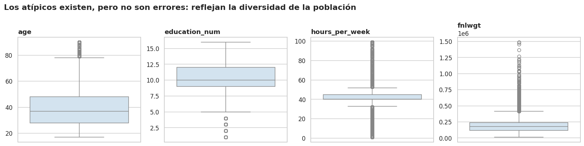

**Interpretación.**

-   `hours_per_week` marca más de **13,000 atípicos (≈28 %)**: parece
    muchísimo, pero es un **artefacto del método**. Como casi la mitad
    de la gente trabaja exactamente 40 h, el rango intercuartílico es
    diminuto (40--45 h) y cualquier valor distinto parece atípico.
    Aplicar la regla del IQR aquí sería un error metodológico.
-   `capital_gain` y `capital_loss` tienen «atípicos» porque **más del
    90 % de las personas tiene cero**: son variables con muchísimos
    ceros, no variables con errores.
-   `age` y `education_num` tienen pocos atípicos y son plausibles
    (personas mayores de 78 años; niveles bajos de escolaridad).

**Decisión:** **no se elimina ningún atípico.** Eliminarlos borraría
justo a las personas con ingresos altos o perfiles atípicos que queremos
estudiar. En su lugar: agrupamos las horas, creamos una categoría y un
logaritmo para el capital y marcamos los valores truncados.

> **Lente · Ingeniería de telecomunicaciones.** El *top-coding* de
> `capital_gain = 99,999` y `age = 90` equivale a la **saturación
> (*clipping*) de un sensor**: la señal real supera el rango del
> instrumento y se registra el máximo. Tratar esos valores como
> mediciones reales distorsionaría promedios, igual que ocurre con una
> señal saturada. La solución es la misma: detectar la saturación,
> **marcarla** y no promediarla como dato válido.

## 5.5 Balance de la variable objetivo

``` python
conteo = df_nan["income"].value_counts()
print(conteo)
print(f"\nProporción: {conteo['<=50K'] / conteo.sum():.1%} (<=50K) vs {conteo['>50K'] / conteo.sum():.1%} (>50K)")
print(f"Razón de desbalance: {conteo['<=50K'] / conteo['>50K']:.2f} a 1")
```


    income
    <=50K    37155
    >50K     11687
    Name: count, dtype: int64

    Proporción: 76.1% (<=50K) vs 23.9% (>50K)
    Razón de desbalance: 3.18 a 1

**Scorecard de calidad (resumen de la auditoría):**

  ------------------------------------------------------------------------------
  Aspecto           Problema                 Magnitud          Tratamiento
  ----------------- ------------------------ ----------------- -----------------
  Faltantes         `"?"` como código de     2,799 / 2,809 /   Categoría
                    faltante en `workclass`, 857 filas (≤ 5.8  explícita
                    `occupation`,            %)                `"No reporta"`
                    `native_country`                           (faltante
                                                               informativo)

  Duplicados        Filas duplicadas exactas 52 filas (0.11 %) Eliminadas;
                                                               efecto ≈ 0.01 pp
                                                               sobre la tasa
                                                               objetivo

  Redundancia       `education` ≡            100 % redundantes Se usa una sola
                    `education_num`                            en cada análisis

  Coherencia        `relationship` vs `sex`  4 casos atípicos  Conservados
                                                               (pueden ser
                                                               legítimos)

  Valores truncados `capital_gain=99,999`,   244 y 55 filas    Se marcan con una
                    `age=90`                                   columna
                                                               indicadora

  Redondeo          *Heaping* en 40 h/semana \~47 % de las     Agrupación por
                                             filas             rangos

  Distribución      Capital con muchísimos   91.7 % de ceros   Categorías y
                    ceros y cola extrema     en ganancias      logaritmo

  Balance           Clase `>50K` minoritaria 76.1 % vs 23.9 %  Se comparan
                                             (3.2 a 1)         tasas, no conteos
  ------------------------------------------------------------------------------

------------------------------------------------------------------------

# 6. Limpieza y transformación 

Aplicamos las decisiones de la sección 5 **paso a paso**, cada una en su
propia celda y con comentarios, para que cualquiera pueda seguir y
repetir el proceso.

> **Lente · Ingeniería de sistemas.** Partimos siempre de una copia
> (`df_nan`), de modo que los datos originales quedan intactos, y
> terminamos con una celda de **validación automática** (`assert`): si
> alguna regla se rompe, el notebook se detiene en lugar de producir
> resultados silenciosamente incorrectos.

**Variables nuevas y su justificación:**

  --------------------------------------------------------------------------
  Variable nueva          Construcción            Para qué sirve
  ----------------------- ----------------------- --------------------------
  `ingreso_alto` y        1 (o 100) si            Su promedio es
  `pct_alto`              `income == ">50K"`, 0   directamente la *tasa* de
                          en caso contrario       ingresos altos

  `nivel_educativo`       5 niveles a partir de   Resume 16 categorías en
                          `education_num`         etapas con significado

  `grupo_edad`,           Rangos ordenados        Capturan relaciones no
  `grupo_horas`                                   lineales y neutralizan el
                                                  *heaping*

  `casado`                1 si                    Resume 7 estados civiles
                          `Married-civ-spouse` o  en un indicador de hogar
                          `Married-AF-spouse`     conyugal
                                                  (`Married-spouse-absent`
                                                  cuenta como no casado
                                                  porque no comparte hogar)

  `tipo_ocupacion`        Agrupa 14 ocupaciones   Lectura de negocio
                          en 5 familias + «No     
                          reporta»                

  `origen`                EE. UU. / Otro país /   Reduce 41 países (muchos
                          No reporta              con pocos casos)

  `categoria_capital`     Ganancia ≥ 5,000 /      Convierte una variable con
                          Ganancia \< 5,000 /     91 % de ceros en
                          Pérdida / Sin           categorías interpretables
                          movimiento              

  `log_capital_gain`      `log(1 + x)`            Comprime una cola extrema

  `flag_tope_edad`,       Indicadores de valores  Evita tratarlos como
  `flag_tope_capital`     truncados               mediciones reales
  --------------------------------------------------------------------------

``` python
# Paso 1. Copia de trabajo y eliminación de duplicados
df = df_nan.copy()
df = df.drop_duplicates().reset_index(drop=True)

# Paso 2. Faltantes: categoría explícita "No reporta"
for col in ["workclass", "occupation", "native_country"]:
    df[col] = df[col].fillna("No reporta")

# Paso 3. Variable objetivo: 1 = ingresos altos (>50K), 0 = no
df["ingreso_alto"] = (df["income"] == ">50K").astype(int)
df["pct_alto"] = df["ingreso_alto"] * 100      # versión en porcentaje, útil para los gráficos

# Paso 4. Indicador de hogar conyugal
df["casado"] = df["marital_status"].isin(["Married-civ-spouse", "Married-AF-spouse"]).astype(int)
df["estado_civil_grupo"] = np.where(df["casado"] == 1, "Casado/a", "No casado/a")
df["pregrado_o_mas"] = (df["education_num"] >= 13).astype(int)

print("Pasos 1-4 listos:", df.shape)
```


    Pasos 1-4 listos: (48790, 20)

``` python
# Paso 5. Grupos ordenados con pd.cut (los límites son los "bins")
niveles = ["1. Sin diploma", "2. Bachiller", "3. Técnico / univ. incompleta", "4. Pregrado", "5. Posgrado"]
df["nivel_educativo"] = pd.cut(df["education_num"], bins=[0, 8, 9, 12, 13, 16], labels=niveles, ordered=True)

grupos_edad = ["17-24", "25-34", "35-44", "45-54", "55-64", "65+"]
df["grupo_edad"] = pd.cut(df["age"], bins=[16, 24, 34, 44, 54, 64, 100], labels=grupos_edad, ordered=True)

grupos_horas = ["≤19", "20-34", "35-40", "41-49", "50-60", ">60"]
df["grupo_horas"] = pd.cut(df["hours_per_week"], bins=[0, 19, 34, 40, 49, 60, 100], labels=grupos_horas, ordered=True)

print(df[["education_num", "nivel_educativo", "age", "grupo_edad", "hours_per_week", "grupo_horas"]].head(5))
```


       education_num nivel_educativo  age grupo_edad  hours_per_week grupo_horas
    0             13     4. Pregrado   39      35-44              40       35-40
    1             13     4. Pregrado   50      45-54              13         ≤19
    2              9    2. Bachiller   38      35-44              40       35-40
    3              7  1. Sin diploma   53      45-54              40       35-40
    4             13     4. Pregrado   28      25-34              40       35-40

``` python
# Paso 6. Familias de ocupación (diccionario: ocupación original -> familia)
familias = {
    "Exec-managerial": "Directivo / Profesional", "Prof-specialty": "Directivo / Profesional",
    "Adm-clerical": "Administrativo / Ventas / Técnico", "Sales": "Administrativo / Ventas / Técnico",
    "Tech-support": "Administrativo / Ventas / Técnico",
    "Craft-repair": "Operativo / Obrero", "Machine-op-inspct": "Operativo / Obrero",
    "Transport-moving": "Operativo / Obrero", "Handlers-cleaners": "Operativo / Obrero",
    "Farming-fishing": "Operativo / Obrero",
    "Other-service": "Servicios", "Protective-serv": "Servicios", "Priv-house-serv": "Servicios",
    "Armed-Forces": "Fuerzas armadas", "No reporta": "No reporta",
}
df["tipo_ocupacion"] = df["occupation"].map(familias)

# Paso 7. Origen: EE. UU. / otro país / no reporta
df["origen"] = "Otro país"
df.loc[df["native_country"] == "United-States", "origen"] = "Estados Unidos"
df.loc[df["native_country"] == "No reporta", "origen"] = "No reporta"

# Paso 8. Movimiento de capital (las condiciones se evalúan de la más específica a la más general)
df["categoria_capital"] = "Sin movimiento"
df.loc[df["capital_loss"] > 0, "categoria_capital"] = "Pérdida"
df.loc[df["capital_gain"] > 0, "categoria_capital"] = "Ganancia < 5,000"
df.loc[df["capital_gain"] >= 5000, "categoria_capital"] = "Ganancia ≥ 5,000"

# Paso 9. Logaritmo del capital e indicadores de valores truncados
df["log_capital_gain"] = np.log1p(df["capital_gain"])      # log(1 + x): permite x = 0
df["flag_tope_edad"] = (df["age"] == 90).astype(int)
df["flag_tope_capital"] = (df["capital_gain"] == 99999).astype(int)

print(df["tipo_ocupacion"].value_counts())
print(df["categoria_capital"].value_counts())
```

    tipo_ocupacion
    Operativo / Obrero                   15030
    Administrativo / Ventas / Técnico    12552
    Directivo / Profesional              12247
    Servicios                             6141
    No reporta                            2805
    Fuerzas armadas                         15
    Name: count, dtype: int64
    categoria_capital
    Sin movimiento      42473
    Ganancia ≥ 5,000     2451
    Pérdida              2282
    Ganancia < 5,000     1584
    Name: count, dtype: int64

``` python
# Paso 10. Validación automática: si alguna regla falla, el notebook se detiene con un error
assert df.duplicated().sum() == 0,                         "Quedan filas duplicadas"
assert df.isna().sum().sum() == 0,                         "Quedan valores nulos"
assert not (df[["workclass", "occupation", "native_country"]] == "?").any().any(), "Quedan '?'"
assert set(df["ingreso_alto"].unique()) == {0, 1},         "El objetivo no es binario"
assert df["age"].between(17, 90).all(),                    "Edad fuera de rango"
assert df["hours_per_week"].between(1, 99).all(),          "Horas fuera de rango"
assert (df[["capital_gain", "capital_loss"]] >= 0).all().all(), "Capital negativo"
assert df["tipo_ocupacion"].notna().all(),                 "Ocupación sin familia asignada"
assert df[["nivel_educativo", "grupo_edad", "grupo_horas"]].notna().all().all(), "Grupo sin asignar"

print("Todas las validaciones pasaron")
print(f"Antes : {df_raw.shape[0]:,} filas × {df_raw.shape[1]} columnas")
print(f"Después: {df.shape[0]:,} filas × {df.shape[1]} columnas")
print(f"Tasa global de ingresos altos: {df['ingreso_alto'].mean():.2%}")
```

    Todas las validaciones pasaron
    Antes : 48,842 filas × 15 columnas
    Después: 48,790 filas × 29 columnas
    Tasa global de ingresos altos: 23.94%

**Lectura.** Las 9 validaciones pasan: el conjunto limpio tiene **48,790
filas, 0 nulos, objetivo binario y todas las variables derivadas
completas**. La tasa global de ingresos altos es **23.94 %**.

**Nota sobre el peso muestral (`fnlwgt`).** Es un peso de diseño del
censo, no una característica de la persona. Analizamos el dato **sin
ponderar** y verificamos en la sección 7.3 que ponderar no cambia las
conclusiones.


------------------------------------------------------------------------

# 7. Estadística descriptiva 

## 7.1 Variables numéricas 

Además de la media y la desviación estándar reportamos la **mediana** y
la **asimetría**, porque la media sola engaña en distribuciones sesgadas
(como el capital).

``` python
cols_num = ["age", "education_num", "hours_per_week", "capital_gain", "capital_loss", "fnlwgt"]

# Resumen estadístico
resumen = df[cols_num].describe().T
resumen["asimetría"] = df[cols_num].skew()     # >0: cola larga a la derecha
display(resumen)

# Porcentaje de ceros y de personas con exactamente 40 horas
print(f"Sin ganancias de capital (capital_gain = 0): {(df['capital_gain'] == 0).mean():.1%}")
print(f"Sin pérdidas de capital (capital_loss = 0) : {(df['capital_loss'] == 0).mean():.1%}")
print(f"Trabajan exactamente 40 horas             : {(df['hours_per_week'] == 40).mean():.1%}")

# Comparación entre los dos grupos de ingreso
print("\nMediana por grupo de ingreso:")
display(df.groupby("income")[cols_num].median())
print("Media por grupo de ingreso:")
display(df.groupby("income")[cols_num].mean())
```

``` json
{"summary":"{\n  \"name\": \"resumen\",\n  \"rows\": 6,\n  \"fields\": [\n    {\n      \"column\": \"count\",\n      \"properties\": {\n        \"dtype\": \"number\",\n        \"std\": 0.0,\n        \"min\": 48790.0,\n        \"max\": 48790.0,\n        \"num_unique_values\": 1,\n        \"samples\": [\n          48790.0\n        ],\n        \"semantic_type\": \"\",\n        \"description\": \"\"\n      }\n    },\n    {\n      \"column\": \"mean\",\n      \"properties\": {\n        \"dtype\": \"number\",\n        \"std\": 77330.52792903177,\n        \"min\": 10.07880713260914,\n        \"max\": 189668.9993646239,\n        \"num_unique_values\": 6,\n        \"samples\": [\n          38.652797704447636\n        ],\n        \"semantic_type\": \"\",\n        \"description\": \"\"\n      }\n    },\n    {\n      \"column\": \"std\",\n      \"properties\": {\n        \"dtype\": \"number\",\n        \"std\": 42575.865206581984,\n        \"min\": 2.570045938993381,\n        \"max\": 105617.23123203602,\n        \"num_unique_values\": 6,\n        \"samples\": [\n          13.708492897985094\n        ],\n        \"semantic_type\": \"\",\n        \"description\": \"\"\n      }\n    },\n    {\n      \"column\": \"min\",\n      \"properties\": {\n        \"dtype\": \"number\",\n        \"std\": 5013.783268816739,\n        \"min\": 0.0,\n        \"max\": 12285.0,\n        \"num_unique_values\": 4,\n        \"samples\": [\n          1.0\n        ],\n        \"semantic_type\": \"\",\n        \"description\": \"\"\n      }\n    },\n    {\n      \"column\": \"25%\",\n      \"properties\": {\n        \"dtype\": \"number\",\n        \"std\": 47985.34342762035,\n        \"min\": 0.0,\n        \"max\": 117555.0,\n        \"num_unique_values\": 5,\n        \"samples\": [\n          9.0\n        ],\n        \"semantic_type\": \"\",\n        \"description\": \"\"\n      }\n    },\n    {\n      \"column\": \"50%\",\n      \"properties\": {\n        \"dtype\": \"number\",\n        \"std\": 72717.6367092262,\n        \"min\": 0.0,\n        \"max\": 178138.5,\n        \"num_unique_values\": 5,\n        \"samples\": [\n          10.0\n        ],\n        \"semantic_type\": \"\",\n        \"description\": \"\"\n      }\n    },\n    {\n      \"column\": \"75%\",\n      \"properties\": {\n        \"dtype\": \"number\",\n        \"std\": 96993.77449022394,\n        \"min\": 0.0,\n        \"max\": 237606.25,\n        \"num_unique_values\": 5,\n        \"samples\": [\n          12.0\n        ],\n        \"semantic_type\": \"\",\n        \"description\": \"\"\n      }\n    },\n    {\n      \"column\": \"max\",\n      \"properties\": {\n        \"dtype\": \"number\",\n        \"std\": 601220.1015646987,\n        \"min\": 16.0,\n        \"max\": 1490400.0,\n        \"num_unique_values\": 6,\n        \"samples\": [\n          90.0\n        ],\n        \"semantic_type\": \"\",\n        \"description\": \"\"\n      }\n    },\n    {\n      \"column\": \"asimetr\\u00eda\",\n      \"properties\": {\n        \"dtype\": \"number\",\n        \"std\": 4.657072840425274,\n        \"min\": -0.3142292065096316,\n        \"max\": 11.888264821933397,\n        \"num_unique_values\": 6,\n        \"samples\": [\n          0.5565823218330223\n        ],\n        \"semantic_type\": \"\",\n        \"description\": \"\"\n      }\n    }\n  ]\n}","type":"dataframe","variable_name":"resumen"}
```

    Sin ganancias de capital (capital_gain = 0): 91.7%
    Sin pérdidas de capital (capital_loss = 0) : 95.3%
    Trabajan exactamente 40 horas             : 46.7%

    Mediana por grupo de ingreso:

``` json
{"summary":"{\n  \"name\": \"display(df\",\n  \"rows\": 2,\n  \"fields\": [\n    {\n      \"column\": \"income\",\n      \"properties\": {\n        \"dtype\": \"string\",\n        \"num_unique_values\": 2,\n        \"samples\": [\n          \">50K\",\n          \"<=50K\"\n        ],\n        \"semantic_type\": \"\",\n        \"description\": \"\"\n      }\n    },\n    {\n      \"column\": \"age\",\n      \"properties\": {\n        \"dtype\": \"number\",\n        \"std\": 6.363961030678928,\n        \"min\": 34.0,\n        \"max\": 43.0,\n        \"num_unique_values\": 2,\n        \"samples\": [\n          43.0,\n          34.0\n        ],\n        \"semantic_type\": \"\",\n        \"description\": \"\"\n      }\n    },\n    {\n      \"column\": \"education_num\",\n      \"properties\": {\n        \"dtype\": \"number\",\n        \"std\": 2.1213203435596424,\n        \"min\": 9.0,\n        \"max\": 12.0,\n        \"num_unique_values\": 2,\n        \"samples\": [\n          12.0,\n          9.0\n        ],\n        \"semantic_type\": \"\",\n        \"description\": \"\"\n      }\n    },\n    {\n      \"column\": \"hours_per_week\",\n      \"properties\": {\n        \"dtype\": \"number\",\n        \"std\": 0.0,\n        \"min\": 40.0,\n        \"max\": 40.0,\n        \"num_unique_values\": 1,\n        \"samples\": [\n          40.0\n        ],\n        \"semantic_type\": \"\",\n        \"description\": \"\"\n      }\n    },\n    {\n      \"column\": \"capital_gain\",\n      \"properties\": {\n        \"dtype\": \"number\",\n        \"std\": 0.0,\n        \"min\": 0.0,\n        \"max\": 0.0,\n        \"num_unique_values\": 1,\n        \"samples\": [\n          0.0\n        ],\n        \"semantic_type\": \"\",\n        \"description\": \"\"\n      }\n    },\n    {\n      \"column\": \"capital_loss\",\n      \"properties\": {\n        \"dtype\": \"number\",\n        \"std\": 0.0,\n        \"min\": 0.0,\n        \"max\": 0.0,\n        \"num_unique_values\": 1,\n        \"samples\": [\n          0.0\n        ],\n        \"semantic_type\": \"\",\n        \"description\": \"\"\n      }\n    },\n    {\n      \"column\": \"fnlwgt\",\n      \"properties\": {\n        \"dtype\": \"number\",\n        \"std\": 1472.196318430392,\n        \"min\": 176729.0,\n        \"max\": 178811.0,\n        \"num_unique_values\": 2,\n        \"samples\": [\n          176729.0\n        ],\n        \"semantic_type\": \"\",\n        \"description\": \"\"\n      }\n    }\n  ]\n}","type":"dataframe"}
```

    Media por grupo de ingreso:

``` json
{"summary":"{\n  \"name\": \"display(df\",\n  \"rows\": 2,\n  \"fields\": [\n    {\n      \"column\": \"income\",\n      \"properties\": {\n        \"dtype\": \"string\",\n        \"num_unique_values\": 2,\n        \"samples\": [\n          \">50K\",\n          \"<=50K\"\n        ],\n        \"semantic_type\": \"\",\n        \"description\": \"\"\n      }\n    },\n    {\n      \"column\": \"age\",\n      \"properties\": {\n        \"dtype\": \"number\",\n        \"std\": 5.227819297128325,\n        \"min\": 36.88275081516613,\n        \"max\": 44.27600376680079,\n        \"num_unique_values\": 2,\n        \"samples\": [\n          44.27600376680079,\n          36.88275081516613\n        ],\n        \"semantic_type\": \"\",\n        \"description\": \"\"\n      }\n    },\n    {\n      \"column\": \"education_num\",\n      \"properties\": {\n        \"dtype\": \"number\",\n        \"std\": 1.4172888594420152,\n        \"min\": 9.598938262955079,\n        \"max\": 11.603287389778272,\n        \"num_unique_values\": 2,\n        \"samples\": [\n          11.603287389778272,\n          9.598938262955079\n        ],\n        \"semantic_type\": \"\",\n        \"description\": \"\"\n      }\n    },\n    {\n      \"column\": \"hours_per_week\",\n      \"properties\": {\n        \"dtype\": \"number\",\n        \"std\": 4.675113042502279,\n        \"min\": 38.842976097442666,\n        \"max\": 45.45458436777673,\n        \"num_unique_values\": 2,\n        \"samples\": [\n          45.45458436777673,\n          38.842976097442666\n        ],\n        \"semantic_type\": \"\",\n        \"description\": \"\"\n      }\n    },\n    {\n      \"column\": \"capital_gain\",\n      \"properties\": {\n        \"dtype\": \"number\",\n        \"std\": 2755.682292121323,\n        \"min\": 147.19254089304482,\n        \"max\": 4044.3158120023973,\n        \"num_unique_values\": 2,\n        \"samples\": [\n          4044.3158120023973,\n          147.19254089304482\n        ],\n        \"semantic_type\": \"\",\n        \"description\": \"\"\n      }\n    },\n    {\n      \"column\": \"capital_loss\",\n      \"properties\": {\n        \"dtype\": \"number\",\n        \"std\": 98.57727092731243,\n        \"min\": 54.21905737152712,\n        \"max\": 193.62837085865937,\n        \"num_unique_values\": 2,\n        \"samples\": [\n          193.62837085865937,\n          54.21905737152712\n        ],\n        \"semantic_type\": \"\",\n        \"description\": \"\"\n      }\n    },\n    {\n      \"column\": \"fnlwgt\",\n      \"properties\": {\n        \"dtype\": \"number\",\n        \"std\": 1104.1405278704497,\n        \"min\": 188481.35125417344,\n        \"max\": 190042.84176345362,\n        \"num_unique_values\": 2,\n        \"samples\": [\n          188481.35125417344,\n          190042.84176345362\n        ],\n        \"semantic_type\": \"\",\n        \"description\": \"\"\n      }\n    }\n  ]\n}","type":"dataframe"}
```

**Interpretación.**

-   **`age`:** media 38.7 y mediana 37 años; distribución casi simétrica
    (asimetría 0.56). Población en edad laboral (la mitad central tiene
    entre 28 y 48 años).
-   **`education_num`:** mediana de 10 (equivale a «algo de
    universidad»); levemente sesgada a la izquierda (−0.31) por el
    pequeño grupo con muy poca escolaridad.
-   **`hours_per_week`:** media 40.4 y mediana 40; el 46.7 % trabaja
    exactamente 40 horas.
-   **`capital_gain` y `capital_loss`:** son **las variables más
    extremas**. La media de `capital_gain` (≈ 1,080) es muy superior a
    su mediana (0) y la asimetría es 11.9: el 91.7 % no tiene ganancias
    y unos pocos acumulan montos enormes (máximo 99,999). Reportar «la
    ganancia de capital promedio» sería engañoso: **la mediana es el
    estadístico representativo**.
-   **`fnlwgt`:** asimetría positiva (1.44), pero no tiene
    interpretación sustantiva (es un peso muestral).
-   **Por grupo de ingreso:** el grupo `>50K` es **más educado**
    (mediana 12 vs 9), **mayor** (43 vs 34 años) y **trabaja más**
    (media 45.5 vs 38.8 h; la mediana es igual, 40, porque en ambos
    grupos domina ese valor, por eso conviene mirar también la media).
    La ganancia de capital media es ≈ 28 veces mayor (4,044 vs 147),
    aunque la mediana de ambos grupos es 0. En `fnlwgt` ambos grupos son
    casi idénticos (medianas ≈ 178,800 vs 176,700), una primera pista de
    que no se relaciona con el ingreso.

## 7.2 Variables categóricas 

``` python
# Para cada variable: cuántas personas hay, qué % representan y qué % tiene ingresos altos
for col in ["sex", "race", "marital_status", "workclass", "nivel_educativo", "tipo_ocupacion", "origen"]:
    tabla = pd.DataFrame({
        "n": df[col].value_counts(),
        "% de la muestra": df[col].value_counts(normalize=True) * 100,
        "% con ingresos >50K": df.groupby(col)["pct_alto"].mean(),
    })
    print(f"--- {col}")
    display(tabla)
```


    --- sex


``` json
{"summary":"{\n  \"name\": \"tabla\",\n  \"rows\": 2,\n  \"fields\": [\n    {\n      \"column\": \"sex\",\n      \"properties\": {\n        \"dtype\": \"string\",\n        \"num_unique_values\": 2,\n        \"samples\": [\n          \"Male\",\n          \"Female\"\n        ],\n        \"semantic_type\": \"\",\n        \"description\": \"\"\n      }\n    },\n    {\n      \"column\": \"n\",\n      \"properties\": {\n        \"dtype\": \"number\",\n        \"std\": 11623,\n        \"min\": 16176,\n        \"max\": 32614,\n        \"num_unique_values\": 2,\n        \"samples\": [\n          32614,\n          16176\n        ],\n        \"semantic_type\": \"\",\n        \"description\": \"\"\n      }\n    },\n    {\n      \"column\": \"% de la muestra\",\n      \"properties\": {\n        \"dtype\": \"number\",\n        \"std\": 23.82336804497739,\n        \"min\": 33.154334904693584,\n        \"max\": 66.84566509530642,\n        \"num_unique_values\": 2,\n        \"samples\": [\n          66.84566509530642,\n          33.154334904693584\n        ],\n        \"semantic_type\": \"\",\n        \"description\": \"\"\n      }\n    },\n    {\n      \"column\": \"% con ingresos >50K\",\n      \"properties\": {\n        \"dtype\": \"number\",\n        \"std\": 13.757400066865793,\n        \"min\": 10.93595450049456,\n        \"max\": 30.39185625804869,\n        \"num_unique_values\": 2,\n        \"samples\": [\n          30.39185625804869,\n          10.93595450049456\n        ],\n        \"semantic_type\": \"\",\n        \"description\": \"\"\n      }\n    }\n  ]\n}","type":"dataframe","variable_name":"tabla"}
```

    --- race

``` json
{"summary":"{\n  \"name\": \"tabla\",\n  \"rows\": 5,\n  \"fields\": [\n    {\n      \"column\": \"race\",\n      \"properties\": {\n        \"dtype\": \"string\",\n        \"num_unique_values\": 5,\n        \"samples\": [\n          \"Asian-Pac-Islander\",\n          \"White\",\n          \"Black\"\n        ],\n        \"semantic_type\": \"\",\n        \"description\": \"\"\n      }\n    },\n    {\n      \"column\": \"n\",\n      \"properties\": {\n        \"dtype\": \"number\",\n        \"std\": 17948,\n        \"min\": 406,\n        \"max\": 41714,\n        \"num_unique_values\": 5,\n        \"samples\": [\n          1517,\n          41714,\n          4683\n        ],\n        \"semantic_type\": \"\",\n        \"description\": \"\"\n      }\n    },\n    {\n      \"column\": \"% de la muestra\",\n      \"properties\": {\n        \"dtype\": \"number\",\n        \"std\": 36.787078496819255,\n        \"min\": 0.8321377331420373,\n        \"max\": 85.4970280795245,\n        \"num_unique_values\": 5,\n        \"samples\": [\n          3.1092436974789917,\n          85.4970280795245,\n          9.598278335724533\n        ],\n        \"semantic_type\": \"\",\n        \"description\": \"\"\n      }\n    },\n    {\n      \"column\": \"% con ingresos >50K\",\n      \"properties\": {\n        \"dtype\": \"number\",\n        \"std\": 7.774160978076039,\n        \"min\": 11.702127659574469,\n        \"max\": 26.961107448912326,\n        \"num_unique_values\": 5,\n        \"samples\": [\n          26.961107448912326,\n          25.413530229659106,\n          12.086269485372624\n        ],\n        \"semantic_type\": \"\",\n        \"description\": \"\"\n      }\n    }\n  ]\n}","type":"dataframe","variable_name":"tabla"}
```

    --- marital_status

``` json
{"summary":"{\n  \"name\": \"tabla\",\n  \"rows\": 7,\n  \"fields\": [\n    {\n      \"column\": \"marital_status\",\n      \"properties\": {\n        \"dtype\": \"string\",\n        \"num_unique_values\": 7,\n        \"samples\": [\n          \"Divorced\",\n          \"Married-AF-spouse\",\n          \"Separated\"\n        ],\n        \"semantic_type\": \"\",\n        \"description\": \"\"\n      }\n    },\n    {\n      \"column\": \"n\",\n      \"properties\": {\n        \"dtype\": \"number\",\n        \"std\": 8829,\n        \"min\": 37,\n        \"max\": 22366,\n        \"num_unique_values\": 7,\n        \"samples\": [\n          6630,\n          37,\n          1530\n        ],\n        \"semantic_type\": \"\",\n        \"description\": \"\"\n      }\n    },\n    {\n      \"column\": \"% de la muestra\",\n      \"properties\": {\n        \"dtype\": \"number\",\n        \"std\": 18.09769239083781,\n        \"min\": 0.07583521213363394,\n        \"max\": 45.84136093461775,\n        \"num_unique_values\": 7,\n        \"samples\": [\n          13.588850174216027,\n          0.07583521213363394,\n          3.1358885017421603\n        ],\n        \"semantic_type\": \"\",\n        \"description\": \"\"\n      }\n    },\n    {\n      \"column\": \"% con ingresos >50K\",\n      \"properties\": {\n        \"dtype\": \"number\",\n        \"std\": 16.544778746886994,\n        \"min\": 4.557890809600796,\n        \"max\": 44.61235804345882,\n        \"num_unique_values\": 7,\n        \"samples\": [\n          10.120663650075414,\n          37.83783783783784,\n          6.470588235294118\n        ],\n        \"semantic_type\": \"\",\n        \"description\": \"\"\n      }\n    }\n  ]\n}","type":"dataframe","variable_name":"tabla"}
```

    --- workclass

``` json
{"summary":"{\n  \"name\": \"tabla\",\n  \"rows\": 9,\n  \"fields\": [\n    {\n      \"column\": \"workclass\",\n      \"properties\": {\n        \"dtype\": \"string\",\n        \"num_unique_values\": 9,\n        \"samples\": [\n          \"State-gov\",\n          \"Local-gov\",\n          \"Self-emp-inc\"\n        ],\n        \"semantic_type\": \"\",\n        \"description\": \"\"\n      }\n    },\n    {\n      \"column\": \"n\",\n      \"properties\": {\n        \"dtype\": \"number\",\n        \"std\": 10743,\n        \"min\": 10,\n        \"max\": 33860,\n        \"num_unique_values\": 9,\n        \"samples\": [\n          1981,\n          3136,\n          1694\n        ],\n        \"semantic_type\": \"\",\n        \"description\": \"\"\n      }\n    },\n    {\n      \"column\": \"% de la muestra\",\n      \"properties\": {\n        \"dtype\": \"number\",\n        \"std\": 22.02012263083241,\n        \"min\": 0.020496003279360527,\n        \"max\": 69.39946710391473,\n        \"num_unique_values\": 9,\n        \"samples\": [\n          4.06025824964132,\n          6.42754662840746,\n          3.472022955523673\n        ],\n        \"semantic_type\": \"\",\n        \"description\": \"\"\n      }\n    },\n    {\n      \"column\": \"% con ingresos >50K\",\n      \"properties\": {\n        \"dtype\": \"number\",\n        \"std\": 16.83732456739374,\n        \"min\": 0.0,\n        \"max\": 55.37190082644628,\n        \"num_unique_values\": 9,\n        \"samples\": [\n          26.754164563351843,\n          29.559948979591837,\n          55.37190082644628\n        ],\n        \"semantic_type\": \"\",\n        \"description\": \"\"\n      }\n    }\n  ]\n}","type":"dataframe","variable_name":"tabla"}
```

    --- nivel_educativo

``` json
{"summary":"{\n  \"name\": \"tabla\",\n  \"rows\": 5,\n  \"fields\": [\n    {\n      \"column\": \"nivel_educativo\",\n      \"properties\": {\n        \"dtype\": \"category\",\n        \"num_unique_values\": 5,\n        \"samples\": [\n          \"2. Bachiller\",\n          \"5. Posgrado\",\n          \"3. T\\u00e9cnico / univ. incompleta\"\n        ],\n        \"semantic_type\": \"\",\n        \"description\": \"\"\n      }\n    },\n    {\n      \"column\": \"n\",\n      \"properties\": {\n        \"dtype\": \"number\",\n        \"std\": 5132,\n        \"min\": 4084,\n        \"max\": 15770,\n        \"num_unique_values\": 5,\n        \"samples\": [\n          15770,\n          4084,\n          14524\n        ],\n        \"semantic_type\": \"\",\n        \"description\": \"\"\n      }\n    },\n    {\n      \"column\": \"% de la muestra\",\n      \"properties\": {\n        \"dtype\": \"number\",\n        \"std\": 10.520115620238066,\n        \"min\": 8.370567739290838,\n        \"max\": 32.32219717155155,\n        \"num_unique_values\": 5,\n        \"samples\": [\n          32.32219717155155,\n          8.370567739290838,\n          29.76839516294323\n        ],\n        \"semantic_type\": \"\",\n        \"description\": \"\"\n      }\n    },\n    {\n      \"column\": \"% con ingresos >50K\",\n      \"properties\": {\n        \"dtype\": \"number\",\n        \"std\": 22.27881523608286,\n        \"min\": 5.719643694327239,\n        \"max\": 61.385896180215475,\n        \"num_unique_values\": 5,\n        \"samples\": [\n          15.859226379201015,\n          61.385896180215475,\n          20.62792619113192\n        ],\n        \"semantic_type\": \"\",\n        \"description\": \"\"\n      }\n    }\n  ]\n}","type":"dataframe","variable_name":"tabla"}
```

    --- tipo_ocupacion

``` json
{"summary":"{\n  \"name\": \"tabla\",\n  \"rows\": 6,\n  \"fields\": [\n    {\n      \"column\": \"tipo_ocupacion\",\n      \"properties\": {\n        \"dtype\": \"string\",\n        \"num_unique_values\": 6,\n        \"samples\": [\n          \"Administrativo / Ventas / T\\u00e9cnico\",\n          \"Directivo / Profesional\",\n          \"Servicios\"\n        ],\n        \"semantic_type\": \"\",\n        \"description\": \"\"\n      }\n    },\n    {\n      \"column\": \"n\",\n      \"properties\": {\n        \"dtype\": \"number\",\n        \"std\": 6037,\n        \"min\": 15,\n        \"max\": 15030,\n        \"num_unique_values\": 6,\n        \"samples\": [\n          12552,\n          12247,\n          6141\n        ],\n        \"semantic_type\": \"\",\n        \"description\": \"\"\n      }\n    },\n    {\n      \"column\": \"% de la muestra\",\n      \"properties\": {\n        \"dtype\": \"number\",\n        \"std\": 12.375198492977347,\n        \"min\": 0.030744004919040786,\n        \"max\": 30.80549292887887,\n        \"num_unique_values\": 6,\n        \"samples\": [\n          25.726583316253333,\n          25.101455216232832,\n          12.586595613855298\n        ],\n        \"semantic_type\": \"\",\n        \"description\": \"\"\n      }\n    },\n    {\n      \"column\": \"% con ingresos >50K\",\n      \"properties\": {\n        \"dtype\": \"number\",\n        \"std\": 14.783721689071651,\n        \"min\": 8.386256310047223,\n        \"max\": 46.44402710867968,\n        \"num_unique_values\": 6,\n        \"samples\": [\n          21.2157425111536,\n          46.44402710867968,\n          8.386256310047223\n        ],\n        \"semantic_type\": \"\",\n        \"description\": \"\"\n      }\n    }\n  ]\n}","type":"dataframe","variable_name":"tabla"}
```

    --- origen

``` json
{"summary":"{\n  \"name\": \"tabla\",\n  \"rows\": 3,\n  \"fields\": [\n    {\n      \"column\": \"origen\",\n      \"properties\": {\n        \"dtype\": \"string\",\n        \"num_unique_values\": 3,\n        \"samples\": [\n          \"Estados Unidos\",\n          \"No reporta\",\n          \"Otro pa\\u00eds\"\n        ],\n        \"semantic_type\": \"\",\n        \"description\": \"\"\n      }\n    },\n    {\n      \"column\": \"n\",\n      \"properties\": {\n        \"dtype\": \"number\",\n        \"std\": 23897,\n        \"min\": 856,\n        \"max\": 43792,\n        \"num_unique_values\": 3,\n        \"samples\": [\n          43792,\n          856,\n          4142\n        ],\n        \"semantic_type\": \"\",\n        \"description\": \"\"\n      }\n    },\n    {\n      \"column\": \"% de la muestra\",\n      \"properties\": {\n        \"dtype\": \"number\",\n        \"std\": 48.979447258038114,\n        \"min\": 1.754457880713261,\n        \"max\": 89.75609756097562,\n        \"num_unique_values\": 3,\n        \"samples\": [\n          89.75609756097562,\n          1.754457880713261,\n          8.48944455831113\n        ],\n        \"semantic_type\": \"\",\n        \"description\": \"\"\n      }\n    },\n    {\n      \"column\": \"% con ingresos >50K\",\n      \"properties\": {\n        \"dtype\": \"number\",\n        \"std\": 3.7462692829269186,\n        \"min\": 18.66248189280541,\n        \"max\": 25.700934579439252,\n        \"num_unique_values\": 3,\n        \"samples\": [\n          24.40628425283157,\n          25.700934579439252,\n          18.66248189280541\n        ],\n        \"semantic_type\": \"\",\n        \"description\": \"\"\n      }\n    }\n  ]\n}","type":"dataframe","variable_name":"tabla"}
```

**Interpretación.**

-   **Composición de la muestra:** 66.8 % hombres y 33.2 % mujeres; 85.5
    % de raza blanca y 9.6 % de raza negra; 89.8 % nació en EE. UU. Es
    una muestra **desbalanceada en atributos sensibles**: las
    conclusiones sobre grupos pequeños (indígenas, «otra raza») tienen
    más incertidumbre.
-   **Empleador:** el sector privado concentra \~69 % de las personas;
    los gobiernos (federal, estatal, local) \~13 %; el trabajo
    independiente \~11 %.
-   **Educación:** el nivel más frecuente es *bachiller* (32 %), seguido
    de *técnico / universidad incompleta* (30 %). Solo el 8.4 % tiene
    posgrado.
-   **Ocupación:** «Operativo/Obrero» es la familia más numerosa (30.8
    %), seguida de «Administrativo/Ventas/Técnico» (25.7 %) y
    «Directivo/Profesional» (25.1 %); «No reporta» representa 5.7 %.
-   **Las tasas de ingresos altos ya revelan jerarquía** (por ejemplo,
    44.6 % de las personas casadas vs 4.6 % de quienes nunca se
    casaron), lo que desarrollaremos en las secciones 9 y 10.

## 7.3 La variable objetivo y la prueba de sensibilidad con el peso muestral 

``` python
# Tasa de ingresos altos sin ponderar y ponderada con fnlwgt
tasa_simple = df["ingreso_alto"].mean() * 100
tasa_ponderada = np.average(df["ingreso_alto"], weights=df["fnlwgt"]) * 100
print(f"Sin ponderar: {tasa_simple:.2f} %")
print(f"Ponderada con fnlwgt: {tasa_ponderada:.2f} %")

# Lo mismo por sexo
simple = df.groupby("sex")["ingreso_alto"].mean() * 100
ponderada = df.groupby("sex").apply(lambda g: np.average(g["ingreso_alto"], weights=g["fnlwgt"])) * 100
print("\nPor sexo (%):")
display(pd.DataFrame({"sin ponderar": simple, "ponderada": ponderada}))

# Gráfico de la variable objetivo
conteo = df["income"].value_counts()
plt.figure(figsize=(5, 3.4))
plt.bar(conteo.index, conteo.values, color=[AZUL, NARANJA])
for i, v in enumerate(conteo.values):
    plt.text(i, v + 400, f"{v:,}\n({v / len(df):.1%})", ha="center", fontweight="bold")
plt.ylim(0, conteo.max() * 1.18)
plt.title("Tres de cada cuatro personas están por debajo de USD 50,000")
plt.ylabel("Personas")
plt.show()
```


    Sin ponderar: 23.94 %
    Ponderada con fnlwgt: 23.79 %

    Por sexo (%):

``` json
{"summary":"{\n  \"name\": \"plt\",\n  \"rows\": 2,\n  \"fields\": [\n    {\n      \"column\": \"sex\",\n      \"properties\": {\n        \"dtype\": \"string\",\n        \"num_unique_values\": 2,\n        \"samples\": [\n          \"Male\",\n          \"Female\"\n        ],\n        \"semantic_type\": \"\",\n        \"description\": \"\"\n      }\n    },\n    {\n      \"column\": \"sin ponderar\",\n      \"properties\": {\n        \"dtype\": \"number\",\n        \"std\": 13.757400066865792,\n        \"min\": 10.93595450049456,\n        \"max\": 30.391856258048687,\n        \"num_unique_values\": 2,\n        \"samples\": [\n          30.391856258048687,\n          10.93595450049456\n        ],\n        \"semantic_type\": \"\",\n        \"description\": \"\"\n      }\n    },\n    {\n      \"column\": \"ponderada\",\n      \"properties\": {\n        \"dtype\": \"number\",\n        \"std\": 13.544192195246058,\n        \"min\": 10.847606931979676,\n        \"max\": 30.001987225884474,\n        \"num_unique_values\": 2,\n        \"samples\": [\n          30.001987225884474,\n          10.847606931979676\n        ],\n        \"semantic_type\": \"\",\n        \"description\": \"\"\n      }\n    }\n  ]\n}","type":"dataframe"}
```

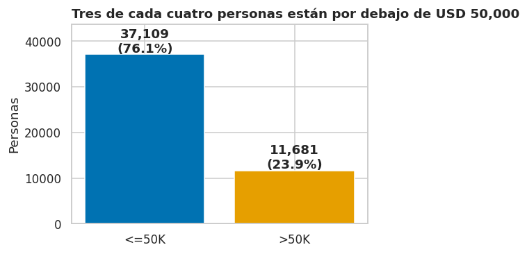


**Interpretación.** La clase `>50K` es minoritaria: 11,681 personas
(**23.9 %**) frente a 37,109 (76.1 %), una razón de **3.2 a 1**. Por eso
a lo largo del análisis **comparamos tasas, no conteos**: una categoría
con muchos ingresos altos en términos absolutos puede ser simplemente
una categoría grande.

**Prueba de sensibilidad:** ponderar con `fnlwgt` casi no altera los
resultados (23.79 % vs 23.94 % de tasa global; 30.0 % vs 30.4 % en
hombres; 10.8 % vs 10.9 % en mujeres). Esto respalda analizar el dato
sin ponderar.

# 8. Visualización univariada 

## 8.1 Distribución de las variables numéricas 

``` python
fig, axes = plt.subplots(2, 3, figsize=(15, 8))

sns.histplot(df["age"], bins=37, color=GRIS, ax=axes[0, 0])
axes[0, 0].set_title("Edad: población en plena vida laboral")

sns.countplot(x=df["education_num"], color=GRIS, ax=axes[0, 1])
axes[0, 1].set_title("Educación: picos en bachiller y pregrado")
axes[0, 1].set_xlabel("Código de educación (9 = bachiller, 13 = pregrado)")

sns.histplot(df["hours_per_week"], bins=50, color=GRIS, ax=axes[0, 2])
axes[0, 2].set_title("Horas: un pico extremo en 40 h/semana")

sns.histplot(df["fnlwgt"] / 1000, bins=60, color=GRIS, ax=axes[1, 0])
axes[1, 0].set_title("fnlwgt (peso muestral): cola larga")
axes[1, 0].set_xlabel("fnlwgt (miles)")

# Capital: solo personas con valor > 0 y escala logarítmica
ganancias = df[df["capital_gain"] > 0]["capital_gain"]
sns.histplot(np.log10(ganancias), bins=40, color=NARANJA, ax=axes[1, 1])
axes[1, 1].set_title(f"Ganancia de capital (solo > 0; {(df['capital_gain'] == 0).mean():.1%} son cero)")
axes[1, 1].set_xlabel("log10(USD): 3 = 1,000; 4 = 10,000; 5 = 100,000")

perdidas = df[df["capital_loss"] > 0]["capital_loss"]
sns.histplot(perdidas, bins=40, color=AZUL, ax=axes[1, 2])
axes[1, 2].set_title(f"Pérdida de capital (solo > 0; {(df['capital_loss'] == 0).mean():.1%} son cero)")
axes[1, 2].set_xlabel("USD")

plt.suptitle("Casi todas las variables numéricas tienen una forma «extrema» que condiciona cómo analizarlas", x=0.01, ha="left", fontweight="bold", fontsize=13)
plt.tight_layout()
plt.show()
```

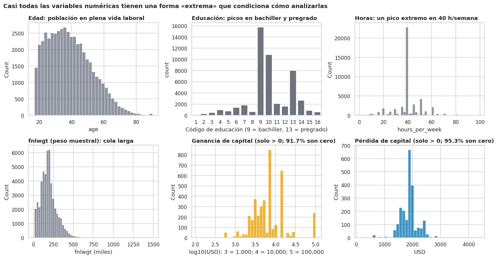

**Interpretación.**

-   **Edad:** distribución con una cola derecha suave y un pequeño pico
    artificial en 90 (valor truncado, no un grupo real de personas de 90
    años).
-   **Educación:** picos claros en los códigos 9 (bachiller) y 10 (algo
    de universidad) y otro en 13 (pregrado). La educación es **ordinal
    pero no uniforme**: hay mucha masa en pocos niveles.
-   **Horas:** pico muy marcado en 40, con picos menores en 50, 45, 60 y
    35 (*heaping*: la gente redondea). Justifica analizar rangos.
-   **`fnlwgt`:** cola larga; no tiene un significado individual.
-   **Capital:** entre las pocas personas con ganancias (8.3 %), los
    montos abarcan varios órdenes de magnitud, con picos en cifras
    específicas y un **pico anómalo en 99,999** (el valor truncado). Las
    pérdidas se concentran alrededor de 1,900 USD. En escala logarítmica
    la distribución se vuelve interpretable.

> **Lente · Ingeniería de telecomunicaciones.** Un rango tan amplio se
> maneja en señales con **escala logarítmica (decibeles)**: comprime
> valores enormes sin perder el detalle de los pequeños. Aplicar
> logaritmo a `capital_gain` es la misma idea: permite comparar «mucho»
> con «poquísimo» sin que unos pocos valores dominen la escala.

## 8.2 Distribución de las variables categóricas 
``` python
variables = ["sex", "race", "workclass", "marital_status", "nivel_educativo", "tipo_ocupacion"]
titulos = ["Sexo", "Raza", "Clase de empleador", "Estado civil", "Nivel educativo", "Tipo de ocupación"]

fig, axes = plt.subplots(2, 3, figsize=(17, 9))
for ax, col, titulo in zip(axes.ravel(), variables, titulos):
    porcentajes = df[col].value_counts(normalize=True).sort_values() * 100
    porcentajes.plot(kind="barh", color=GRIS, ax=ax)
    ax.bar_label(ax.containers[0], fmt="%.1f%%", padding=3, fontsize=8.5)   # etiqueta sobre cada barra
    ax.set_xlim(0, porcentajes.max() * 1.2)
    ax.set_title(titulo)
    ax.set_xlabel("% de personas")
    ax.set_ylabel("")
plt.suptitle("Perfil de la muestra: mayoría hombres, blancos, empleados del sector privado", x=0.01, ha="left", fontweight="bold", fontsize=13)
plt.tight_layout()
plt.show()
```


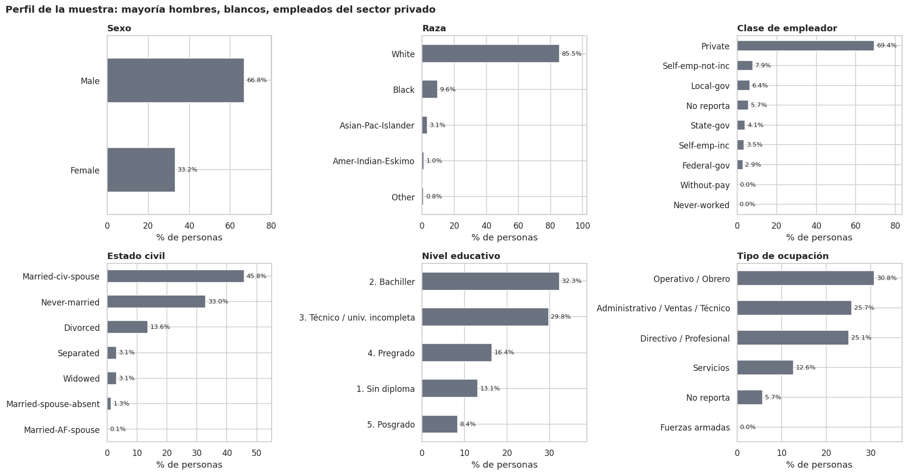

**Interpretación.** La muestra está dominada por hombres (66.8 %),
personas blancas (85.5 %), empleados del sector privado (69.4 %),
casados con cónyuge en el hogar (45.9 %) y nacidos en EE. UU. (89.8 %).
Esto tiene dos implicaciones: (1) los grupos minoritarios tienen **más
incertidumbre**, por eso en los gráficos siguientes mostramos barras de
error (intervalo de confianza del 95 %) y las tablas con `n`; (2)
cualquier modelo futuro aprenderá sobre todo el patrón del grupo
mayoritario, lo que es un riesgo de sesgo.

> **Lente · Diseño multimedia.** Ordenamos las barras de menor a mayor
> (o por orden natural en variables como la educación), usamos un único
> color neutro cuando solo se describe composición y etiquetamos los
> valores directamente sobre las barras para no depender del eje.

# 9. Relaciones con la variable objetivo 

## 9.1 Variables numéricas frente al ingreso 

``` python
fig, axes = plt.subplots(1, 4, figsize=(17, 4.5))
for ax, col, titulo in zip(axes, ["age", "education_num", "hours_per_week", "fnlwgt"],
                           ["Edad (años)", "Educación (código)", "Horas por semana", "fnlwgt (peso muestral)"]):
    sns.boxplot(data=df, x="income", y=col, order=["<=50K", ">50K"], hue="income",
                palette={"<=50K": AZUL, ">50K": NARANJA}, legend=False, ax=ax)
    ax.set_title(titulo)
    ax.set_xlabel("")
    ax.set_ylabel("")
plt.tight_layout()
plt.show()

# Mediana de cada variable por grupo
display(df.groupby("income")[["age", "education_num", "hours_per_week", "fnlwgt"]].median())
```

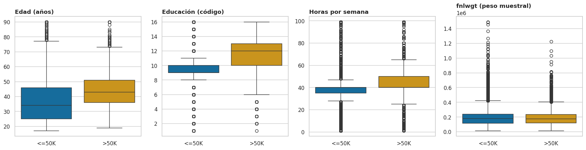

``` json
{"summary":"{\n  \"name\": \"display(df\",\n  \"rows\": 2,\n  \"fields\": [\n    {\n      \"column\": \"income\",\n      \"properties\": {\n        \"dtype\": \"string\",\n        \"num_unique_values\": 2,\n        \"samples\": [\n          \">50K\",\n          \"<=50K\"\n        ],\n        \"semantic_type\": \"\",\n        \"description\": \"\"\n      }\n    },\n    {\n      \"column\": \"age\",\n      \"properties\": {\n        \"dtype\": \"number\",\n        \"std\": 6.363961030678928,\n        \"min\": 34.0,\n        \"max\": 43.0,\n        \"num_unique_values\": 2,\n        \"samples\": [\n          43.0,\n          34.0\n        ],\n        \"semantic_type\": \"\",\n        \"description\": \"\"\n      }\n    },\n    {\n      \"column\": \"education_num\",\n      \"properties\": {\n        \"dtype\": \"number\",\n        \"std\": 2.1213203435596424,\n        \"min\": 9.0,\n        \"max\": 12.0,\n        \"num_unique_values\": 2,\n        \"samples\": [\n          12.0,\n          9.0\n        ],\n        \"semantic_type\": \"\",\n        \"description\": \"\"\n      }\n    },\n    {\n      \"column\": \"hours_per_week\",\n      \"properties\": {\n        \"dtype\": \"number\",\n        \"std\": 0.0,\n        \"min\": 40.0,\n        \"max\": 40.0,\n        \"num_unique_values\": 1,\n        \"samples\": [\n          40.0\n        ],\n        \"semantic_type\": \"\",\n        \"description\": \"\"\n      }\n    },\n    {\n      \"column\": \"fnlwgt\",\n      \"properties\": {\n        \"dtype\": \"number\",\n        \"std\": 1472.196318430392,\n        \"min\": 176729.0,\n        \"max\": 178811.0,\n        \"num_unique_values\": 2,\n        \"samples\": [\n          176729.0\n        ],\n        \"semantic_type\": \"\",\n        \"description\": \"\"\n      }\n    }\n  ]\n}","type":"dataframe"}
```

**Interpretación.**

-   **Edad:** la mediana es 34 años en `<=50K` y 43 en `>50K`; el grupo
    de ingresos altos casi no tiene personas menores de 25.
-   **Educación:** la mediana pasa de 9 (bachiller) a 12 (técnico /
    título en curso), y la caja del grupo `>50K` se extiende hasta el
    nivel de posgrado.
-   **Horas:** ambos grupos tienen mediana 40, pero la caja y los
    bigotes del grupo `>50K` llegan mucho más arriba: trabajan más
    horas.
-   **`fnlwgt`:** las dos cajas son prácticamente idénticas (medianas ≈
    178,800 vs 176,700). El peso muestral **no distingue** a quienes
    ganan más de quienes ganan menos, lo que respalda H7.

## 9.2 Tasa de ingresos altos por edad, educación y horas 

Pasamos de comparar distribuciones a medir **la probabilidad de ingresos
altos dentro de cada categoría**. Cada barra es el promedio de
`pct_alto` (porcentaje con ingresos \> USD 50,000); la línea negra fina
es el intervalo de confianza del 95 % y la línea punteada, el promedio
general (23.9 %).

``` python
promedio = df["pct_alto"].mean()      # promedio general (23.9 %)

fig, axes = plt.subplots(1, 3, figsize=(17, 4.8))
for ax, col, titulo in zip(axes, ["grupo_edad", "nivel_educativo", "grupo_horas"],
                           ["Edad: forma de U invertida, pico a los 45–54",
                            "Educación: el gran salto ocurre en el pregrado",
                            "Horas: sube hasta 60 h y luego retrocede"]):
    sns.barplot(data=df, x=col, y="pct_alto", color=NARANJA, seed=SEMILLA, ax=ax)   # barras con IC 95 %
    ax.bar_label(ax.containers[0], fmt="%.1f%%", padding=12, fontsize=9, fontweight="bold")
    ax.axhline(promedio, color=GRIS, ls="--", lw=1)
    ax.set_title(titulo)
    ax.set_xlabel("")
    ax.set_ylabel("% con ingresos > USD 50,000")
plt.setp(axes[1].get_xticklabels(), rotation=20, ha="right")    # etiquetas inclinadas para que no se encimen
plt.tight_layout()
plt.show()

# Tamaño de cada grupo (para saber qué tan confiable es cada barra)
for col in ["grupo_edad", "nivel_educativo", "grupo_horas"]:
    print(col, df[col].value_counts().sort_index().to_dict())
```

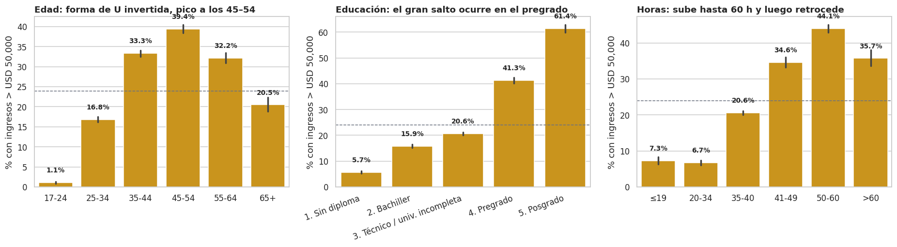

    grupo_edad {'17-24': 8409, '25-34': 12564, '35-44': 12184, '45-54': 8765, '55-64': 4782, '65+': 2086}
    nivel_educativo {'1. Sin diploma': 6399, '2. Bachiller': 15770, '3. Técnico / univ. incompleta': 14524, '4. Pregrado': 8013, '5. Posgrado': 4084}
    grupo_horas {'≤19': 2586, '20-34': 5800, '35-40': 26061, '41-49': 4667, '50-60': 8000, '>60': 1676}

**Interpretación (H1, H2, H3).**

-   **Edad (H2 ✔):** la relación es **no lineal**. Solo 1.1 % de las
    personas de 17--24 años supera el umbral; sube a 16.8 % (25--34),
    33.3 % (35--44) y alcanza el **máximo de 39.4 % entre 45 y 54
    años**; luego baja a 32.2 % (55--64) y 20.5 % (65+). Es el ciclo de
    vida laboral: acumulación de experiencia, ascenso y retiro.
-   **Educación (H1 ✔):** la tasa crece de forma ordenada (5.7 % sin
    diploma → 15.9 % bachiller → 20.6 % técnico/universidad incompleta →
    41.3 % pregrado → 61.4 % posgrado), pero **no de forma lineal**: el
    mayor salto (≈ +21 puntos) ocurre al pasar de «técnico/universidad
    incompleta» a «pregrado completo». Terminar el título parece pesar
    más que cursar años sueltos.
-   **Horas (H3 ✔ con matiz):** la tasa se triplica entre ≤34 h (≈7 %) y
    41--49 h (34.6 %) y llega a **44.1 % en 50--60 h**, pero **cae a
    35.7 % por encima de 60 h**. Más horas se asocian con más ingresos
    hasta un punto; después aparecen rendimientos decrecientes (el dato
    no permite saber por qué).

> **Lente · Administración de empresas.** La prima de la educación es
> una medida directa de **retorno de la inversión en capital humano**:
> pasar de bachiller a pregrado multiplica por 2.6 la probabilidad de
> estar en el grupo de ingresos altos, y de bachiller a posgrado por
> 3.9. Para una empresa, esto sugiere que los programas de financiación
> de estudios y las rutas de carrera que ayuden a completar el pregrado
> pueden ser la palanca de retención y movilidad más rentable.

## 9.3 Tasa de ingresos altos por ocupación, empleador, estado civil y rol en el hogar 


``` python
fig, axes = plt.subplots(2, 2, figsize=(16, 10))
for ax, col, titulo in zip(axes.ravel(), ["occupation", "workclass", "marital_status", "relationship"],
                           ["Ocupación: directivos y profesionales lideran",
                            "Empleador: ser dueño de empresa incorporada marca la diferencia",
                            "Estado civil: estar casado/a lo cambia todo",
                            "Rol en el hogar: esposo/a vs el resto"]):
    orden = df.groupby(col)["pct_alto"].mean().sort_values(ascending=False).index    # de mayor a menor tasa
    sns.barplot(data=df, y=col, x="pct_alto", order=orden, color=NARANJA, seed=SEMILLA, ax=ax)
    tasas = df.groupby(col)["pct_alto"].mean()[orden]
    for i, v in enumerate(tasas):                       # etiqueta en una columna fija a la derecha
        ax.text(79, i, f"{v:.1f}%", va="center", ha="right", fontsize=9, fontweight="bold")
    ax.axvline(promedio, color=GRIS, ls="--", lw=1)
    ax.set_title(titulo)
    ax.set_xlabel("% con ingresos > USD 50,000")
    ax.set_ylabel("")
    ax.set_xlim(0, 80)
plt.tight_layout()
plt.show()
```

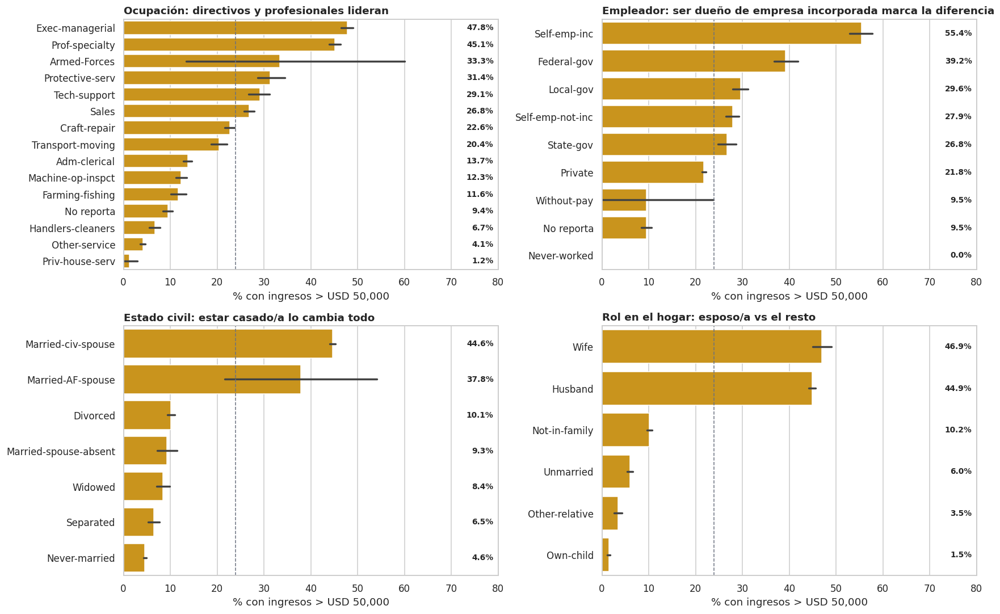

**Interpretación (H5 ✔).**

-   **Ocupación:** `Exec-managerial` (47.8 %) y `Prof-specialty` (45.1
    %) superan el 45 %; en el extremo opuesto, `Other-service` (4.1 %),
    `Handlers-cleaners` (6.7 %) y `Priv-house-serv` (1.2 %). La brecha
    entre extremos es de más de 40 veces. Las Fuerzas Armadas
    (`Armed-Forces`, solo 15 personas) tienen una barra de error enorme
    y no se interpretan. Quienes **no reportan ocupación** tienen apenas
    9.4 %, confirmando que el faltante es informativo.
-   **Empleador:** los dueños de empresa incorporada (`Self-emp-inc`)
    alcanzan **55.4 %**, por encima de cualquier empleado: el
    emprendimiento formal es la clase de empleo más rentable. Los
    empleados federales (39.2 %) superan a los del sector privado (21.8
    %). Los independientes no incorporados (27.9 %) quedan cerca del
    promedio; la **incorporación** parece ser la diferencia relevante.
    `Never-worked` y `Without-pay` tienen muy pocos casos (10 y 21), así
    que sus barras son poco confiables.
-   **Estado civil y rol en el hogar:** es la señal más fuerte del
    análisis. **Casados con cónyuge en el hogar: 44.6 %** frente a 4.6 %
    de quienes nunca se casaron, 10.1 % de divorciados y 8.4 % de
    viudos. Por rol: esposa (46.9 %) y esposo (44.9 %) vs hijo/a (1.5 %)
    o «sin familia» (10.2 %). El hecho de que **tanto esposos como
    esposas** presenten tasas altas sugiere que el efecto proviene de la
    **estructura del hogar** (dos adultos y, posiblemente, ingreso
    conjunto) y no de ser hombre o mujer. Lo retomamos en la sección
    10.3.

## 9.4 Sexo, raza, origen y capital 


``` python
fig, axes = plt.subplots(1, 4, figsize=(19, 4.8))
ordenes = [["Female", "Male"], None, ["Estados Unidos", "Otro país", "No reporta"],
           ["Sin movimiento", "Pérdida", "Ganancia < 5,000", "Ganancia ≥ 5,000"]]
for ax, col, titulo, orden in zip(axes, ["sex", "race", "origen", "categoria_capital"],
                                  ["Sexo", "Raza", "Origen", "Movimiento de capital"], ordenes):
    sns.barplot(data=df, x=col, y="pct_alto", order=orden, color=NARANJA, seed=SEMILLA, ax=ax)
    ax.bar_label(ax.containers[0], fmt="%.1f%%", padding=12, fontsize=9, fontweight="bold")
    ax.axhline(promedio, color=GRIS, ls="--", lw=1)
    ax.set_title(titulo)
    ax.set_xlabel("")
    ax.set_ylabel("% con ingresos > USD 50,000")
plt.setp(axes[1].get_xticklabels(), rotation=20, ha="right")
plt.setp(axes[3].get_xticklabels(), rotation=15, ha="right")
plt.tight_layout()
plt.show()
```

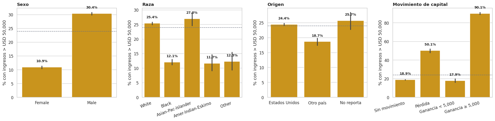

**Interpretación (H6 ✔).**

-   **Sexo:** 30.4 % de los hombres vs 10.9 % de las mujeres, una
    diferencia de **19.5 puntos**. Es un hallazgo bruto que **no debe
    leerse como causal**; la sección 10.3 lo descompone.
-   **Raza:** las personas asiáticas/isleñas del Pacífico (27.0 %) y
    blancas (25.4 %) superan a las negras (12.1 %), indígenas americanas
    (11.7 %) y «otra» (12.3 %). Son diferencias descriptivas sin control
    por educación, ocupación o región, y los grupos pequeños tienen
    barras de error más largas.
-   **Origen:** 24.4 % para nacidos en EE. UU. y 18.7 % para otros
    países, un grupo muy heterogéneo (por ejemplo, México ≈ 5.0 %,
    Alemania ≈ 28.2 %, Filipinas ≈ 28.9 %). El origen por sí solo es
    poco informativo.
-   **Capital:** quien tiene **ganancias ≥ 5,000** supera el umbral en
    el **90.1 %** de los casos; entre quienes reportan pérdidas la tasa
    es 50.1 %; y entre quienes no tienen movimiento, 18.9 % (y 17.9 %
    entre quienes tienen ganancias menores a 5,000). Tener capital
    invertido es un **marcador de patrimonio**: no se pierde en bolsa lo
    que no se tiene.

## 9.5 Correlaciones y pruebas de asociación 

``` python
# Correlación de Spearman entre variables numéricas y el objetivo
# (Spearman usa rangos, por eso funciona bien con variables muy sesgadas como el capital)
cols_corr = ["age", "education_num", "hours_per_week", "capital_gain", "capital_loss", "fnlwgt", "ingreso_alto"]
correlacion = df[cols_corr].corr(method="spearman")

plt.figure(figsize=(7.5, 6))
sns.heatmap(correlacion, annot=True, fmt=".2f", cmap="RdBu_r", center=0, vmin=-1, vmax=1, linewidths=.5)
plt.title("Correlaciones de Spearman")
plt.show()

# Variables categóricas: prueba chi-cuadrado y diferencia entre la tasa más alta y la más baja
# (solo categorías con al menos 100 personas, para que las tasas sean confiables)
filas = []
for col in ["relationship", "marital_status", "education", "occupation", "sex", "workclass", "race", "native_country"]:
    tabla = pd.crosstab(df[col], df["income"])
    chi2, p, gl, esperados = chi2_contingency(tabla)
    grupos = df.groupby(col)["pct_alto"].agg(["mean", "count"])
    grupos = grupos[grupos["count"] >= 100]
    filas.append({"variable": col, "p-valor": p, "tasa más baja (%)": grupos["mean"].min(),
                  "tasa más alta (%)": grupos["mean"].max(),
                  "diferencia (puntos)": grupos["mean"].max() - grupos["mean"].min()})
tabla_asociacion = pd.DataFrame(filas).set_index("variable").sort_values("diferencia (puntos)", ascending=False)
tabla_asociacion["p-valor"] = tabla_asociacion["p-valor"].apply(lambda p: f"{p:.1e}")   # notación científica
display(tabla_asociacion)
```


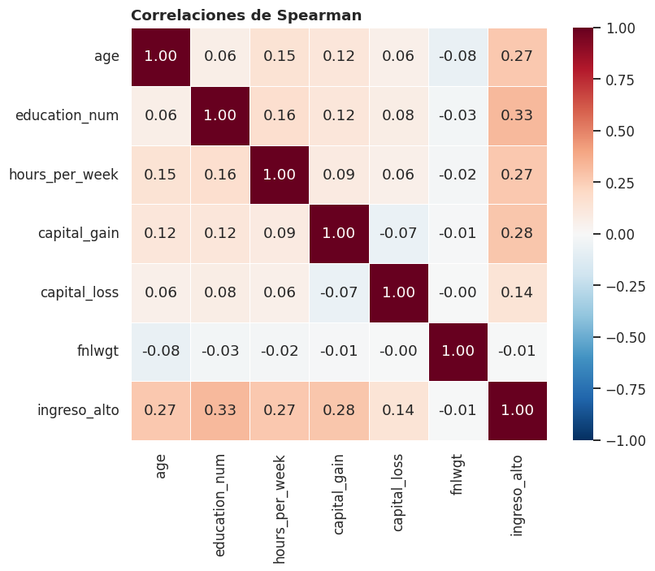

``` json
{"summary":"{\n  \"name\": \"tabla_asociacion\",\n  \"rows\": 8,\n  \"fields\": [\n    {\n      \"column\": \"variable\",\n      \"properties\": {\n        \"dtype\": \"string\",\n        \"num_unique_values\": 8,\n        \"samples\": [\n          \"occupation\",\n          \"native_country\",\n          \"education\"\n        ],\n        \"semantic_type\": \"\",\n        \"description\": \"\"\n      }\n    },\n    {\n      \"column\": \"p-valor\",\n      \"properties\": {\n        \"dtype\": \"category\",\n        \"num_unique_values\": 3,\n        \"samples\": [\n          \"0.0e+00\",\n          \"3.8e-70\",\n          \"3.4e-104\"\n        ],\n        \"semantic_type\": \"\",\n        \"description\": \"\"\n      }\n    },\n    {\n      \"column\": \"tasa m\\u00e1s baja (%)\",\n      \"properties\": {\n        \"dtype\": \"number\",\n        \"std\": 4.191026512001168,\n        \"min\": 1.25,\n        \"max\": 11.702127659574469,\n        \"num_unique_values\": 8,\n        \"samples\": [\n          1.25,\n          4.854368932038835,\n          3.2653061224489797\n        ],\n        \"semantic_type\": \"\",\n        \"description\": \"\"\n      }\n    },\n    {\n      \"column\": \"tasa m\\u00e1s alta (%)\",\n      \"properties\": {\n        \"dtype\": \"number\",\n        \"std\": 14.672778971412491,\n        \"min\": 26.961107448912326,\n        \"max\": 73.98081534772182,\n        \"num_unique_values\": 8,\n        \"samples\": [\n          47.78033541598158,\n          41.05960264900662,\n          73.98081534772182\n        ],\n        \"semantic_type\": \"\",\n        \"description\": \"\"\n      }\n    },\n    {\n      \"column\": \"diferencia (puntos)\",\n      \"properties\": {\n        \"dtype\": \"number\",\n        \"std\": 17.315367396012878,\n        \"min\": 15.258979789337857,\n        \"max\": 70.71550922527284,\n        \"num_unique_values\": 8,\n        \"samples\": [\n          46.53033541598158,\n          36.20523371696778,\n          70.71550922527284\n        ],\n        \"semantic_type\": \"\",\n        \"description\": \"\"\n      }\n    }\n  ]\n}","type":"dataframe","variable_name":"tabla_asociacion"}
```

**Interpretación.**

-   **Correlaciones:** se usa **Spearman** y no Pearson porque
    `capital_gain` y `capital_loss` son extremadamente sesgadas y
    `education_num` es ordinal. Las correlaciones con `ingreso_alto` son
    moderadas: **educación (0.33), ganancias de capital (0.28), edad
    (0.27) y horas (0.27)**. Entre las variables explicativas son bajas
    (≤ 0.16), por lo que **no hay redundancia numérica preocupante**.
    `fnlwgt` tiene correlación prácticamente nula con todo (−0.01 con el
    objetivo): **confirma H7**, el peso muestral no aporta información
    sobre el ingreso.
-   **Pruebas chi-cuadrado:** todas las variables categóricas tienen
    p-valor muy pequeño. Con casi 49,000 registros, casi cualquier
    diferencia sale «significativa», así que **lo importante es el
    tamaño de la diferencia**, no el p-valor. La última columna mide qué
    tanto separa cada variable a sus categorías: estado civil, rol en el
    hogar, ocupación, educación y empleador separan a las personas en
    más de 40 puntos porcentuales; sexo en cerca de 20 puntos y raza en
    15 puntos. El país de origen muestra 36 puntos, pero esa diferencia
    sale de países pequeños (con \~100 a 300 personas): el 89.8 % de la
    muestra es de EE. UU., así que como variable aporta poco. Un p-valor
    de `0.0e+00` significa que es tan pequeño que el computador lo
    redondea a cero.

> **Lente · Ingeniería de telecomunicaciones.** En una señal, un
> componente sin relación con lo que se mide es **ruido**. `fnlwgt` se
> comporta así: correlación ≈ 0, cajas idénticas en ambos grupos. La
> práctica de ingeniería es identificar ese ruido y **dejarlo fuera**
> antes de modelar, y priorizar las variables que sí transportan
> información (estado civil, educación, ocupación, capital).

------------------------------------------------------------------------

# 10. Patrones e interacciones 

Las relaciones de a una variable cuentan solo parte de la historia. Aquí
estudiamos **combinaciones**: cómo se potencian (o se cancelan) las
variables entre sí.

## 10.1 Edad × horas trabajadas 

``` python
# Tabla cruzada: % de ingresos altos para cada combinación de edad y horas
tabla_edad_horas = df.pivot_table(index="grupo_edad", columns="grupo_horas", values="pct_alto", aggfunc="mean")
n_edad_horas = df.pivot_table(index="grupo_edad", columns="grupo_horas", values="pct_alto", aggfunc="count")

plt.figure(figsize=(9, 5))
sns.heatmap(tabla_edad_horas, annot=True, fmt=".0f", cmap="YlOrBr", vmin=0, vmax=60, linewidths=.6,
            cbar_kws={"label": "% con ingresos > USD 50,000"})
plt.xlabel("Horas por semana")
plt.ylabel("Grupo de edad")
plt.title("Edad × horas: el «punto dulce» está en 45–54 años trabajando 50–60 h")
plt.show()

print("Número de personas en la celda más pequeña:", n_edad_horas.min().min())
```


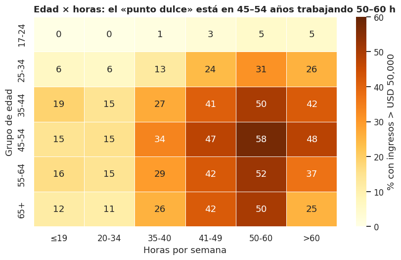

    Número de personas en la celda más pequeña: 51

**Interpretación.** Los efectos de edad y horas **se multiplican**: la
combinación de **45--54 años y 50--60 horas** alcanza **57.5 %** de
ingresos altos, mientras que quienes tienen 17--24 años casi nunca
superan el umbral aunque trabajen muchas horas (≤ 5 %). Esto indica que
**la experiencia (edad) es una condición necesaria**: trabajar más horas
no compensa la falta de trayectoria. También se aprecia en casi todas
las filas la caída por encima de 60 h. La celda más pequeña tiene 51
personas, suficiente para una lectura general.

## 10.2 Educación × ocupación: ¿la educación rinde igual en todos los trabajos?
``` python
# Quitamos dos ocupaciones con muy pocas personas (15 y 240) para que las celdas del mapa sean confiables
d_ocup = df[~df["occupation"].isin(["Armed-Forces", "Priv-house-serv"])]

tabla_edu_ocup = d_ocup.pivot_table(index="occupation", columns="nivel_educativo", values="pct_alto", aggfunc="mean")
tabla_edu_ocup = tabla_edu_ocup.loc[d_ocup.groupby("occupation")["pct_alto"].mean().sort_values(ascending=False).index]

plt.figure(figsize=(10, 6.5))
sns.heatmap(tabla_edu_ocup, annot=True, fmt=".0f", cmap="YlOrBr", vmin=0, vmax=80, linewidths=.6,
            cbar_kws={"label": "% con ingresos > USD 50,000"})
plt.xlabel("Nivel educativo")
plt.ylabel("")
plt.title("Educación × ocupación: el título «paga» distinto según el oficio")
plt.xticks(rotation=15)
plt.show()
```

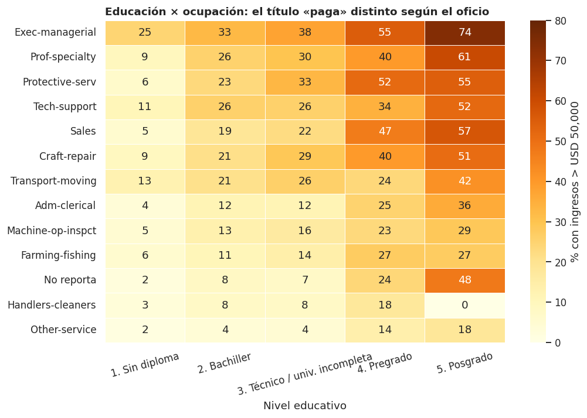

**Interpretación.** Hay **dos efectos que se suman**: la educación sube
la probabilidad *dentro* de cada ocupación, y la ocupación define el
techo. Por ejemplo, un posgrado en `Exec-managerial` implica \~74 % de
ingresos altos, en `Prof-specialty` \~61 %, mientras que en
`Other-service` apenas \~18 %. En el otro sentido, un directivo *sin
diploma* (\~25 %) supera a una persona en servicios con posgrado. Dos
conclusiones: (1) la educación **no es suficiente** si se queda atrapada
en ocupaciones de baja remuneración; (2) la **experiencia/ocupación**
puede compensar parcialmente la falta de título en roles directivos. Las
celdas de posgrado en ocupaciones poco comunes (como `Handlers-cleaners`
o `Farming-fishing`) se basan en muy pocas personas y deben leerse con
cautela.

## 10.3 La brecha de género: de 19.5 puntos a casi cero 

``` python
colores_sexo = {"Female": ROSA, "Male": VERDE}
fig, axes = plt.subplots(1, 3, figsize=(18, 4.8))

# (a) Por grupo de edad: una línea por sexo
por_edad = df.groupby(["grupo_edad", "sex"])["pct_alto"].mean().unstack()
por_edad = por_edad.rename(columns={"Female": "Mujeres", "Male": "Hombres"})
por_edad.plot(marker="o", lw=2.2, color=[ROSA, VERDE], ax=axes[0])
axes[0].set_title("a) Por edad: la brecha existe en casi todas las edades")
axes[0].set_xlabel("Grupo de edad")
axes[0].set_ylabel("% con ingresos > USD 50,000")
axes[0].legend(title="")

# (b) Por nivel educativo
sns.barplot(data=df, x="nivel_educativo", y="pct_alto", hue="sex", palette=colores_sexo, errorbar=None, ax=axes[1])
axes[1].set_title("b) Por educación: la brecha también persiste")
axes[1].set_xlabel("")
axes[1].set_ylabel("")
axes[1].set_xticklabels([n[3:] for n in niveles], rotation=20, ha="right", fontsize=8.5)
axes[1].legend(title="")

# (c) Por estado civil: el hallazgo clave
sns.barplot(data=df, x="estado_civil_grupo", y="pct_alto", hue="sex", palette=colores_sexo, errorbar=None,
            order=["No casado/a", "Casado/a"], ax=axes[2])
for contenedor in axes[2].containers:
    axes[2].bar_label(contenedor, fmt="%.1f%%", padding=2, fontweight="bold")
axes[2].set_title("c) Por estado civil: entre casados la brecha desaparece")
axes[2].set_xlabel("")
axes[2].set_ylabel("")
axes[2].set_ylim(0, 55)
axes[2].legend(title="")
plt.tight_layout()
plt.show()

# Composición: ¿qué porcentaje de cada sexo está casado? ¿y qué parte de los ingresos altos aportan?
print("% de cada sexo que está casado/a:")
print(df.groupby("sex")["casado"].mean() * 100)

altos = df[df["ingreso_alto"] == 1]
print("\nComposición del grupo >50K (% del total de ingresos altos):")
print((altos.groupby(["estado_civil_grupo", "sex"]).size() / len(altos) * 100).round(1))

print("\nCasados/as con pregrado o más: % de ingresos altos por sexo")
print(df[(df["casado"] == 1) & (df["pregrado_o_mas"] == 1)].groupby("sex")["pct_alto"].mean())
```


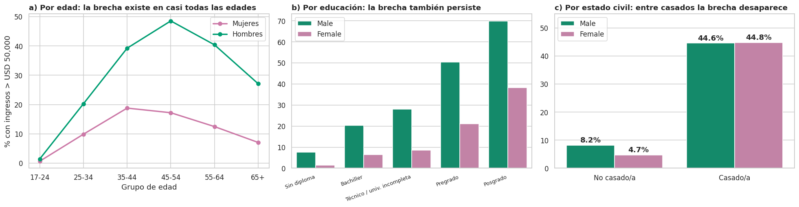

    % de cada sexo que está casado/a:
    sex
    Female   15.49
    Male     61.01
    Name: casado, dtype: float64

    Composición del grupo >50K (% del total de ingresos altos):
    estado_civil_grupo  sex   
    Casado/a            Female    9.60
                        Male     75.90
    No casado/a         Female    5.50
                        Male      8.90
    dtype: float64

    Casados/as con pregrado o más: % de ingresos altos por sexo
    sex
    Female   71.90
    Male     71.82
    Name: pct_alto, dtype: float64

**Interpretación (H4 ✔ con matiz).** La brecha bruta (**30.4 % vs 10.9
%**) existe en casi todas las edades y niveles educativos (paneles a y
b), lo que sugiere un fenómeno estructural. Pero el panel c cambia la
lectura:

-   **Entre personas casadas, hombres y mujeres alcanzan prácticamente
    la misma tasa** (44.6 % vs 44.8 %). La brecha se concentra en el
    grupo **no casado** (8.2 % vs 4.7 %), donde las tasas son bajas para
    ambos.
-   La **composición** explica el resto: el **61.0 % de los hombres** de
    la muestra está casado frente al 15.5 % de las mujeres, y el 75.9 %
    de todos los ingresos altos corresponde a hombres casados.
-   Entre personas casadas con pregrado o más, la tasa es **71.9 % en
    mujeres y 71.8 % en hombres**.

**¿Por qué ocurre esto?** El dato no permite afirmarlo, pero sugiere dos
hipótesis a validar con la fuente original: (1) que el *ingreso
reportado en hogares casados* refleje ingreso conjunto del hogar y no el
individual, y/o (2) que sea un efecto real de la **estructura del
hogar** (doble ingreso, jefe de hogar). **No es correcto concluir ni que
«no hay brecha de género» ni que «toda la brecha es discriminación»**:
lo que muestra el dato es que el estado civil confunde fuertemente la
comparación. El Anexo A (opcional) cuantifica este efecto con un modelo
estadístico: la razón de odds de los hombres frente a las mujeres baja
de 3.56 a 1.14 al incluir el estado civil.

> **Lente · Administración de empresas.** Este es un ejemplo práctico de
> la **paradoja de Simpson / confusión**: un indicador agregado (brecha
> de 19.5 puntos) puede contar una historia distinta al desglosarlo. En
> una auditoría de equidad salarial dentro de una empresa, el análisis
> correcto compara *personas comparables* (mismo cargo, antigüedad,
> horas) y no solo promedios globales.

## 10.4 Concentración del capital: ¿quién gana con el capital? 

``` python
# Ordenamos las ganancias de mayor a menor
ganancias = df["capital_gain"].sort_values(ascending=False)
total = ganancias.sum()

# ¿Qué % del total de ganancias concentra el 1 %, 5 % y 10 % de las personas con más ganancias?
concentracion = {}
for porcentaje_personas in [1, 5, 10]:
    n_personas = int(len(df) * porcentaje_personas / 100)
    concentracion[f"Top {porcentaje_personas} %"] = ganancias.head(n_personas).sum() / total * 100

# Las personas con el valor truncado 99,999
participacion_truncados = df.loc[df["flag_tope_capital"] == 1, "capital_gain"].sum() / total * 100

plt.figure(figsize=(6.5, 4))
plt.bar(concentracion.keys(), concentracion.values(), color=NARANJA)
for i, v in enumerate(concentracion.values()):
    plt.text(i, v + 1.5, f"{v:.1f} %", ha="center", fontweight="bold")
plt.ylim(0, 110)
plt.ylabel("% del total de ganancias de capital")
plt.title("Unas pocas personas concentran casi todo el capital")
plt.show()

print(f"Personas con ganancia de capital > 0: {(df['capital_gain'] > 0).mean():.1%}")
print(f"Las {df['flag_tope_capital'].sum()} personas con el valor truncado 99,999 concentran el {participacion_truncados:.1f} % de TODA la ganancia registrada")
print("\n% de ingresos altos según movimiento de capital:")
print(df.groupby("categoria_capital")["pct_alto"].agg(["mean", "count"]))
```


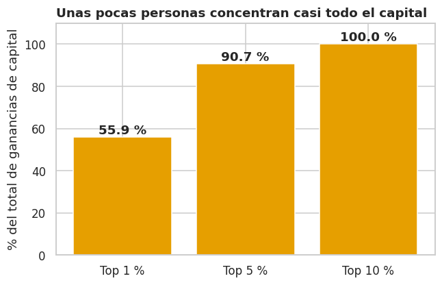

    Personas con ganancia de capital > 0: 8.3%
    Las 244 personas con el valor truncado 99,999 concentran el 46.3 % de TODA la ganancia registrada

    % de ingresos altos según movimiento de capital:
                       mean  count
    categoria_capital             
    Ganancia < 5,000  17.87   1584
    Ganancia ≥ 5,000  90.09   2451
    Pérdida           50.13   2282
    Sin movimiento    18.94  42473

**Interpretación (H6 ✔).** Las ganancias de capital están
**extremadamente concentradas**: el **1 % de las personas acumula el 56
%** del total, el 5 % acumula el 91 %, y solo el 8.3 % de la muestra
tiene alguna ganancia. Además, **244 personas con el valor truncado
99,999 concentran ≈ 46 % de toda la ganancia registrada**: una fracción
desproporcionada del total depende de un código de saturación y no de
montos reales. Para modelos o promedios esto es un riesgo: **la media
del capital está dominada por un puñado de registros truncados**, lo que
refuerza la decisión de usar categorías, logaritmos y medianas.

> **Lente · Administración de empresas.** La concentración tipo Pareto
> es familiar en negocios: pocos clientes generan la mayor parte del
> valor. Aquí, ganar con capital es un fenómeno **de nicho** (8 % de la
> población) pero **de altísimo valor** (≥ 5,000 USD implica 90 % de
> probabilidad de ingresos altos). Para segmentar mercados de inversión
> o banca privada, ese 8 % es el objetivo, no el promedio.

## 10.5 Segmentos de perfil 

``` python
# Combinamos dos condiciones: estar casado/a y tener pregrado o más
segmentos = df.groupby(["casado", "pregrado_o_mas"])["pct_alto"].agg(["mean", "count"])
segmentos.columns = ["% con ingresos >50K", "n personas"]
segmentos["veces el promedio"] = segmentos["% con ingresos >50K"] / promedio
segmentos["% de todos los >50K"] = segmentos["% con ingresos >50K"] / 100 * segmentos["n personas"] / df["ingreso_alto"].sum() * 100
segmentos.index = ["Sin pareja en hogar · sin pregrado", "Sin pareja en hogar · con pregrado+",
                   "Casado/a · sin pregrado", "Casado/a · con pregrado+"]
display(segmentos)

plt.figure(figsize=(8, 3.6))
plt.barh(segmentos.index, segmentos["% con ingresos >50K"], color=[AZUL, AZUL, NARANJA, NARANJA])
for i, v in enumerate(segmentos["% con ingresos >50K"]):
    plt.text(v + 1, i, f"{v:.1f} %", va="center", fontweight="bold")
plt.axvline(promedio, color=GRIS, ls="--", lw=1)
plt.xlim(0, 90)
plt.xlabel("% con ingresos > USD 50,000")
plt.title("Hogar conyugal + pregrado: el perfil con mayor probabilidad")
plt.show()
```


``` json
{"summary":"{\n  \"name\": \"segmentos\",\n  \"rows\": 4,\n  \"fields\": [\n    {\n      \"column\": \"% con ingresos >50K\",\n      \"properties\": {\n        \"dtype\": \"number\",\n        \"std\": 29.382984596623462,\n        \"min\": 3.149305721238727,\n        \"max\": 71.83140842957852,\n        \"num_unique_values\": 4,\n        \"samples\": [\n          18.950276243093924,\n          71.83140842957852,\n          3.149305721238727\n        ],\n        \"semantic_type\": \"\",\n        \"description\": \"\"\n      }\n    },\n    {\n      \"column\": \"n personas\",\n      \"properties\": {\n        \"dtype\": \"number\",\n        \"std\": 7430,\n        \"min\": 5430,\n        \"max\": 20957,\n        \"num_unique_values\": 4,\n        \"samples\": [\n          5430,\n          6667,\n          20957\n        ],\n        \"semantic_type\": \"\",\n        \"description\": \"\"\n      }\n    },\n    {\n      \"column\": \"veces el promedio\",\n      \"properties\": {\n        \"dtype\": \"number\",\n        \"std\": 1.2272886041171633,\n        \"min\": 0.1315423560818744,\n        \"max\": 3.0003034134741338,\n        \"num_unique_values\": 4,\n        \"samples\": [\n          0.7915281036731038,\n          3.0003034134741338,\n          0.1315423560818744\n        ],\n        \"semantic_type\": \"\",\n        \"description\": \"\"\n      }\n    },\n    {\n      \"column\": \"% de todos los >50K\",\n      \"properties\": {\n        \"dtype\": \"number\",\n        \"std\": 20.61072601559413,\n        \"min\": 5.650201181405703,\n        \"max\": 44.54241931341494,\n        \"num_unique_values\": 4,\n        \"samples\": [\n          8.809177296464346,\n          40.998202208715,\n          5.650201181405703\n        ],\n        \"semantic_type\": \"\",\n        \"description\": \"\"\n      }\n    }\n  ]\n}","type":"dataframe","variable_name":"segmentos"}
```

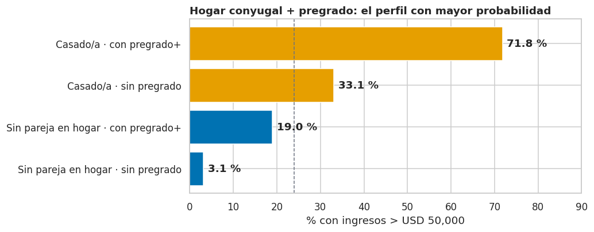

**Interpretación.** Combinando solo dos condiciones ---estar casado/a y
tener pregrado o más--- se separa a la población de forma muy marcada:
**«casado/a con pregrado+» tiene 71.8 % de ingresos altos (3.0 veces el
promedio)** y reúne \~41 % de todas las personas `>50K` con solo el 13.7
% de la muestra; en el extremo opuesto, **«sin pareja en hogar y sin
pregrado» tiene 3.1 % (0.13 veces el promedio)**. Es una regla simple,
fácil de explicar y consistente con todo lo visto antes.

------------------------------------------------------------------------

# 11. Resumen visual ejecutivo {#11-resumen-visual-ejecutivo}

> **Lente · Diseño multimedia.** Una página, una historia: cuatro
> paneles con un titular explícito, jerarquía visual clara y la misma
> codificación de color del resto del informe. Pensada para proyectarse
> o incluirse en una presentación a perfiles no técnicos.

``` python
fig, axes = plt.subplots(2, 2, figsize=(16, 10.5))

# 1. Educación
sns.barplot(data=df, x="nivel_educativo", y="pct_alto", color=NARANJA, errorbar=None, ax=axes[0, 0])
axes[0, 0].bar_label(axes[0, 0].containers[0], fmt="%.0f%%", fontweight="bold")
axes[0, 0].set_xticklabels([n[3:] for n in niveles], rotation=20, ha="right")
axes[0, 0].set_title("1 · El título pesa: pregrado = 2.6 veces la tasa del bachiller")

# 2. Edad
por_edad_total = df.groupby("grupo_edad")["pct_alto"].mean()
axes[0, 1].plot(por_edad_total.index.astype(str), por_edad_total.values, marker="o", lw=3, color="#D55E00")
for i, v in enumerate(por_edad_total.values):
    axes[0, 1].text(i, v + 2, f"{v:.0f}%", ha="center", fontweight="bold")
axes[0, 1].set_ylim(0, 50)
axes[0, 1].set_title("2 · El ingreso alto llega con la experiencia: pico a los 45–54")

# 3. Segmentos
axes[1, 0].barh(segmentos.index, segmentos["% con ingresos >50K"], color=[AZUL, AZUL, NARANJA, NARANJA])
for i, v in enumerate(segmentos["% con ingresos >50K"]):
    axes[1, 0].text(v + 1, i, f"{v:.1f}%", va="center", fontweight="bold")
axes[1, 0].set_xlim(0, 90)
axes[1, 0].set_title("3 · Hogar conyugal + pregrado: el perfil con mayor probabilidad")

# 4. Brecha de género según estado civil
sns.barplot(data=df, x="estado_civil_grupo", y="pct_alto", hue="sex", palette=colores_sexo, errorbar=None,
            order=["No casado/a", "Casado/a"], ax=axes[1, 1])
for contenedor in axes[1, 1].containers:
    axes[1, 1].bar_label(contenedor, fmt="%.1f%%", fontweight="bold")
axes[1, 1].set_ylim(0, 55)
axes[1, 1].set_title("4 · Entre personas casadas no hay brecha de género")
axes[1, 1].legend(title="")

for ax in axes.ravel():
    ax.set_xlabel("")
    if ax is not axes[1, 0]:
        ax.set_ylabel("% con ingresos > USD 50,000")
    else:
        ax.set_ylabel("")
plt.suptitle("Adult Income · Qué se asocia con ganar más de USD 50,000 (promedio general: 23.9 %)", x=0.01, ha="left", fontweight="bold", fontsize=15)
plt.tight_layout(rect=[0, 0, 1, .96])
plt.show()
```


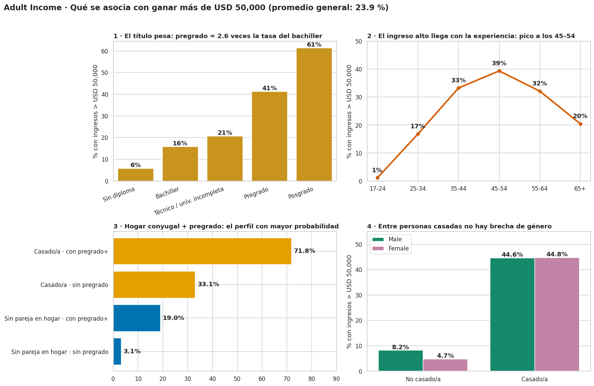

**Lectura.** Si solo se pudiera conservar una figura del informe, sería
esta: cuatro mensajes independientes ---**educación, ciclo de vida,
estructura del hogar y la doble lectura de la brecha de género**--- que
resumen la mayor parte de lo que el dataset puede decirnos.

# 12. Del análisis a la decisión: aplicaciones por perfil profesional {#12-del-análisis-a-la-decisión-aplicaciones-por-perfil-profesional}

Cada integrante leyó los mismos datos con las herramientas de su
disciplina. La tabla consolida **qué evidencia de este notebook usa cada
perfil y qué decisión concreta habilita**.

  -----------------------------------------------------------------------
  Perfil                  Evidencia que utiliza   Aplicación concreta
  ----------------------- ----------------------- -----------------------
  **Administración de     Prima de la educación   **Segmentación de
  empresas** (Jhonathan)  (15.9 % → 41.3 % → 61.4 clientes y talento:**
                          %); segmento «casado/a  definir un perfil de
                          con pregrado+» (71.8 %, alto poder adquisitivo
                          3.0 veces el promedio); (banca privada,
                          `Self-emp-inc` 55.4 %;  inversión, seguros),
                          capital concentrado en  diseñar planes de
                          el 8 % de la población  financiación de
                                                  estudios y rutas de
                                                  carrera en RR. HH., y
                                                  plantear auditorías de
                                                  equidad salarial
                                                  comparando personas
                                                  comparables.

  **Ingeniería de         Limpieza paso a paso y  **Proceso de datos
  sistemas** (Camilo y    documentada;            reproducible y
  Diego)                  validaciones            auditable:** el mismo
                          automáticas con         código puede
                          `assert`; copia intacta reutilizarse con nuevos
                          de los datos            extractos y es la base
                          originales; fuente de   del trabajo previo a un
                          datos trazable          modelo (selección y
                                                  construcción de
                                                  variables).

  **Ingeniería de         Detección de saturación **Fiabilidad de la
  telecomunicaciones**    (`99,999`, `age = 90`); señal:** decidir qué
  (Johan)                 `fnlwgt` como ruido sin variables *transmiten
                          relación con el         información* antes de
                          ingreso; escala         modelar, tratar valores
                          logarítmica para el     truncados como
                          capital; peso muestral  saturación de sensor y
                          y prueba de             usar escalas
                          sensibilidad            logarítmicas ante
                                                  rangos amplios; la
                                                  misma lógica aplica a
                                                  datos de red (tráfico,
                                                  latencia, fallas).

  **Diseño multimedia**   Paleta Okabe-Ito, color **Comunicación de datos
  (Luisa)                 consistente, títulos    accesible:** convertir
                          que enuncian el         los hallazgos en una
                          hallazgo, barras de     historia para
                          error, figura-resumen   audiencias no técnicas
                          de la sección 11        (un tablero o
                                                  infografía de una
                                                  página), evitando
                                                  gráficos que exageran
                                                  diferencias con
                                                  muestras pequeñas.
  -----------------------------------------------------------------------

**Un hallazgo transversal.** Los cuatro lentes convergen: la variable
más poderosa (estado civil / hogar) es también la más delicada de
interpretar. Administración la lee como *segmento de mercado*, sistemas
como una *variable derivada que hay que validar*, telecomunicaciones
como *una señal confundida con su contexto* y diseño como *una historia
que no debe simplificarse en exceso*.

# 13. Conclusiones, limitaciones y recomendaciones 

## 13.1 Contraste de hipótesis {

  -----------------------------------------------------------------------
  \#                Hipótesis         Veredicto         Evidencia clave
  ----------------- ----------------- ----------------- -----------------
  H1                Más educación →   **Confirmada**    15.9 %
                    más ingresos                        (bachiller) →
                    altos                               41.3 % (pregrado)
                                                        → 61.4 %
                                                        (posgrado). El
                                                        mayor salto es
                                                        completar el
                                                        pregrado.

  H2                Relación no       **Confirmada**    U invertida: 1.1
                    lineal con la                       % → 39.4 %
                    edad                                (45--54) → 20.5 %
                                                        (65+).

  H3                Más horas → más   **Confirmada**    Máximo en 50--60
                    ingresos, con                       h (44.1 %); cae a
                    rendimientos                        35.7 % en \> 60
                    decrecientes                        h; el efecto
                                                        requiere
                                                        experiencia (mapa
                                                        edad × horas).

  H4                Existe brecha de  **Confirmada con  30.4 % vs 10.9 %;
                    género y parte se matiz**           entre casados
                    explica por otras                   44.6 % vs 44.8 %;
                    variables                           en no casados
                                                        persiste (8.2 %
                                                        vs 4.7 %). El
                                                        Anexo A: razón de
                                                        odds 3.56 → 1.14.

  H5                Ocupación y       **Confirmada**    De 1.2 %
                    empleador                           (servicio
                    segmentan los                       doméstico) a 47.8
                    ingresos                            % (directivos);
                                                        `Self-emp-inc`
                                                        55.4 %. La
                                                        educación rinde
                                                        distinto según la
                                                        ocupación.

  H6                Capital: raro,    **Confirmada**    8.3 % con
                    concentrado y muy                   ganancias; el 1 %
                    asociado a                          concentra 56 %
                    ingresos altos                      del total; ≥
                                                        5,000 USD → 90.1
                                                        % de ingresos
                                                        altos.

  H7                `fnlwgt` no tiene **Confirmada**    Correlación de
                    relación con el                     Spearman −0.01;
                    ingreso                             cajas casi
                                                        idénticas entre
                                                        grupos.
  -----------------------------------------------------------------------

## 13.2 Conclusiones principales 

1.  **Los ingresos altos se explican por una combinación, no por un
    único factor.** Hogar conyugal, educación formal completada y etapa
    del ciclo laboral separan a la población mejor que cualquier otra
    variable. El perfil «casado/a con pregrado o más» concentra 3 veces
    la probabilidad promedio.
2.  **La educación es una inversión con retornos escalonados**, y su
    rendimiento depende de la ocupación. Un título en un oficio de baja
    remuneración rinde mucho menos que el mismo título en un cargo
    directivo o profesional.
3.  **La brecha de género agregada es real en los datos, pero su lectura
    es compleja**: gran parte se asocia a la estructura del hogar.
    Quedan una brecha residual y una brecha clara entre personas no
    casadas que merecen atención.
4.  **La calidad del dato condiciona las conclusiones**: faltantes
    informativos, valores truncados (99,999) y una variable de peso
    muestral sin relación con el ingreso. Tratar estos casos con
    criterio fue tan importante como cualquier gráfica.

## 13.3 Limitaciones 

-   **Antigüedad y contexto:** datos de 1994 en EE. UU.; el umbral de
    USD 50,000 y la estructura laboral y familiar de hoy son distintos.
    Los patrones sirven como ilustración metodológica más que como
    estimación actual.
-   **Variable objetivo binaria:** pierde información (50,001 y 500,000
    USD se ven igual) y el umbral es arbitrario.
-   **Ingreso individual vs. del hogar:** el dataset no aclara cómo se
    midió para personas casadas, lo que afecta la interpretación de
    género.
-   **Asociación ≠ causalidad:** no controlamos variables omitidas
    (región, industria, antigüedad).
-   **Representatividad:** análisis sin ponderar (justificado por la
    prueba de sensibilidad) y grupos minoritarios pequeños con más
    incertidumbre.
-   **Truncamiento:** los valores 99,999 y 90 son códigos, no
    mediciones.

## 13.4 Recomendaciones 

**Para decisiones de negocio y de personas (Administración):**

1.  Priorizar las **rutas de titulación** (completar el pregrado,
    posgrado) en planes de beneficios de formación: es el punto de mayor
    salto en la tasa de ingresos altos.
2.  En auditorías de equidad salarial, **comparar personas comparables**
    y separar ingreso individual de ingreso del hogar antes de emitir
    diagnósticos.
3.  Usar el perfil de segmentación («hogar conyugal + pregrado+ + 45--54
    años + 50--60 h») como hipótesis de mercado de alto poder
    adquisitivo, validada con datos propios y actuales.

**Para el trabajo de datos y modelado (Sistemas y Telecomunicaciones):**

1.  **Dejar fuera `fnlwgt`** de los modelos y **no usar `education`
    junto con `education_num`** (son la misma información).
2.  Usar categorías o logaritmo para `capital_gain` y `capital_loss`, y
    tratar `99,999` como valor truncado.
3.  Mantener la categoría `"No reporta"` y **dividir los datos de forma
    estratificada** (3.2 a 1 de desbalance); evaluar con métricas
    distintas de la exactitud, como la capacidad de detectar la clase
    `>50K`.
4.  Si se construye un modelo, hacer una **auditoría de equidad**
    (errores por sexo y raza) y vigilar variables que puedan actuar como
    sustitutas del sexo (p. ej. `relationship`, que contiene
    esposo/esposa).

**Para la comunicación (Diseño):**

1.  Mostrar siempre el tamaño de cada grupo y las barras de error en
    grupos pequeños; usar el resumen visual de la sección 11 como pieza
    independiente para audiencias no técnicas.

**Próximos pasos:** (i) un modelo base con validación cruzada, (ii)
técnicas de interpretación del modelo para contrastar con este EDA y
(iii) comparación con datos actuales para evaluar qué patrones
persisten.

# 14. Reproducibilidad y referencias {#14-reproducibilidad-y-referencias}

**Cómo ejecutar este notebook.** Funciona sin modificaciones en Jupyter
local o en Google Colab (*Entorno de ejecución → Ejecutar todo*).
Requisitos: Python 3.9 o superior y las librerías `numpy`, `pandas`,
`matplotlib`, `seaborn` y `scipy` (el Anexo A además usa `statsmodels`);
todas vienen preinstaladas en Colab. Se necesita conexión a internet
para descargar el dataset (sección 3). Los resultados que dependen del
azar usan la semilla `SEMILLA = 42`, y las versiones de las librerías se
imprimen en la sección 2.

**Referencias.**

-   Becker, B. & Kohavi, R. (1996). *Adult* \[Dataset\]. UCI Machine
    Learning Repository. <https://doi.org/10.24432/C5XW20>
-   Kohavi, R. (1996). Scaling up the accuracy of Naive-Bayes
    classifiers: a decision-tree hybrid. *Proceedings of the 2nd
    International Conference on Knowledge Discovery and Data Mining
    (KDD-96)*.
-   Brownlee, J. (s. f.). *Datasets* \[Repositorio de GitHub\].
    <https://github.com/jbrownlee/Datasets> (archivo `adult-all.csv`).
-   Okabe, M. & Ito, K. (2008). *Color Universal Design (CUD): How to
    make figures and presentations that are friendly to colorblind
    people.*

**Contribución del equipo.** Todas las decisiones de análisis fueron
discutidas en conjunto; cada integrante lideró el lente de su profesión
(ver portada y sección 12).

------------------------------------------------------------------------

# Anexo A (opcional): modelo estadístico de la brecha de género

> Esta sección es **complementaria**. Si no se necesita, puede
> eliminarse sin afectar el resto del informe.

Para cuantificar cuánto de la brecha entre hombres y mujeres se debe a
otras variables, usamos una **regresión logística** y comparamos cómo
cambia la *razón de odds* (OR) de los hombres frente a las mujeres al ir
agregando variables. Un OR de 1 significa «sin diferencia»; un OR de 3.5
significa que las odds de ingresos altos de los hombres son 3.5 veces
las de las mujeres.

``` python
import statsmodels.formula.api as smf

df["hombre"] = (df["sex"] == "Male").astype(int)    # 1 = hombre, 0 = mujer

# Cuatro modelos: cada uno agrega variables al anterior
modelos = {
    "M0 · solo sexo": "ingreso_alto ~ hombre",
    "M1 · + edad, educación, horas": "ingreso_alto ~ hombre + age + education_num + hours_per_week",
    "M2 · + ocupación y capital": "ingreso_alto ~ hombre + age + education_num + hours_per_week + C(occupation) + log_capital_gain",
    "M3 · + estado civil (casado)": "ingreso_alto ~ hombre + age + education_num + hours_per_week + C(occupation) + log_capital_gain + casado",
}

filas = []
for nombre, formula in modelos.items():
    modelo = smf.logit(formula, data=df).fit(disp=0, maxiter=200)       # ajusta el modelo
    odds = np.exp(modelo.params["hombre"])                              # OR de ser hombre
    intervalo = np.exp(modelo.conf_int().loc["hombre"])                 # intervalo de confianza 95 %
    filas.append({"modelo": nombre, "OR hombre vs mujer": odds, "IC 95 % inferior": intervalo[0], "IC 95 % superior": intervalo[1]})

tabla_or = pd.DataFrame(filas).set_index("modelo")
display(tabla_or)

plt.figure(figsize=(8, 3.4))
plt.barh(tabla_or.index[::-1], tabla_or["OR hombre vs mujer"][::-1], color=[AZUL, "#D55E00", "#D55E00", "#D55E00"])
for i, v in enumerate(tabla_or["OR hombre vs mujer"][::-1]):
    plt.text(v + 0.05, i, f"{v:.2f}", va="center", fontweight="bold")
plt.axvline(1, color=GRIS, ls="--")
plt.xlabel("Razón de odds hombre vs mujer (1 = sin brecha)")
plt.title("Al incluir el estado civil, la brecha baja de 3.56 a 1.14")
plt.show()
```


``` json
{"summary":"{\n  \"name\": \"tabla_or\",\n  \"rows\": 4,\n  \"fields\": [\n    {\n      \"column\": \"modelo\",\n      \"properties\": {\n        \"dtype\": \"string\",\n        \"num_unique_values\": 4,\n        \"samples\": [\n          \"M1 \\u00b7 + edad, educaci\\u00f3n, horas\",\n          \"M3 \\u00b7 + estado civil (casado)\",\n          \"M0 \\u00b7 solo sexo\"\n        ],\n        \"semantic_type\": \"\",\n        \"description\": \"\"\n      }\n    },\n    {\n      \"column\": \"OR hombre vs mujer\",\n      \"properties\": {\n        \"dtype\": \"number\",\n        \"std\": 1.1060105815557952,\n        \"min\": 1.138139573678361,\n        \"max\": 3.5558456186999767,\n        \"num_unique_values\": 4,\n        \"samples\": [\n          3.1951020370381467,\n          1.138139573678361,\n          3.5558456186999767\n        ],\n        \"semantic_type\": \"\",\n        \"description\": \"\"\n      }\n    },\n    {\n      \"column\": \"IC 95 % inferior\",\n      \"properties\": {\n        \"dtype\": \"number\",\n        \"std\": 1.0527764903356343,\n        \"min\": 1.0525926929917546,\n        \"max\": 3.366476906187714,\n        \"num_unique_values\": 4,\n        \"samples\": [\n          3.0084183273363725,\n          1.0525926929917546,\n          3.366476906187714\n        ],\n        \"semantic_type\": \"\",\n        \"description\": \"\"\n      }\n    },\n    {\n      \"column\": \"IC 95 % superior\",\n      \"properties\": {\n        \"dtype\": \"number\",\n        \"std\": 1.1618479791818386,\n        \"min\": 1.2306390665614362,\n        \"max\": 3.7558665680396004,\n        \"num_unique_values\": 4,\n        \"samples\": [\n          3.3933701753917944,\n          1.2306390665614362,\n          3.7558665680396004\n        ],\n        \"semantic_type\": \"\",\n        \"description\": \"\"\n      }\n    }\n  ]\n}","type":"dataframe","variable_name":"tabla_or"}
```

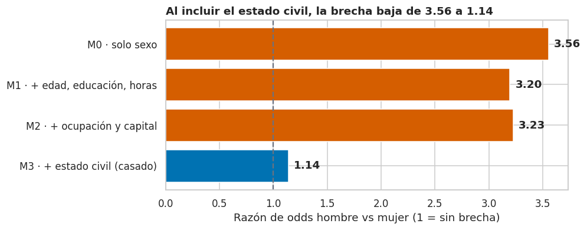

**Interpretación.**

-   **M0:** sin controles, los hombres tienen **3.56 veces las odds** de
    ingresos altos.
-   **M1 y M2:** controlar por edad, educación, horas, ocupación y
    capital **apenas reduce** la brecha (a \~3.2): hombres y mujeres del
    mismo nivel educativo, horas y ocupación siguen estando muy
    separados.
-   **M3:** al añadir **estado civil**, la razón de odds cae a **1.14**
    (intervalo de confianza 95 %: 1.05--1.23). El estado civil absorbe
    alrededor del 90 % de la brecha (medida en escala logarítmica);
    queda una diferencia pequeña pero estadísticamente distinta de 1.

**Cautelas:** (i) es un modelo descriptivo, no causal; (ii) el estado
civil podría ser un *mediador* (consecuencia de desigualdades) o un
artefacto de cómo se registró el ingreso del hogar, y el dato no permite
distinguirlos; (iii) entre personas no casadas la brecha sigue
existiendo (8.2 % vs 4.7 %).

